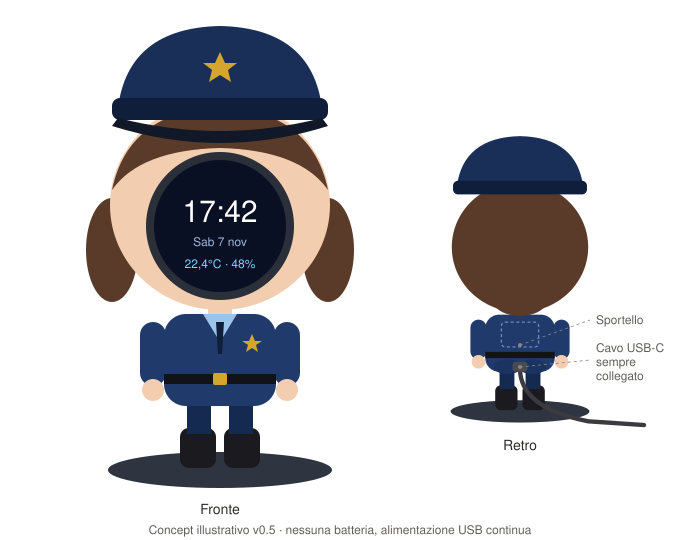
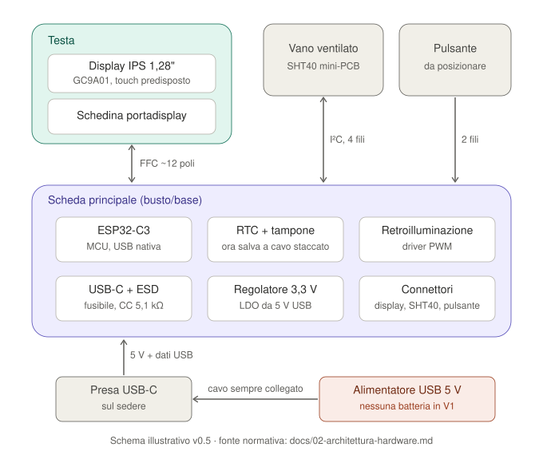

# PoliClock

**Orologio da scrivania alimentato via USB, integrato nel volto di una poliziotta chibi stampata in 3D.**

> Stato: **specifiche preliminari (v0.6), schema KiCad rev 0.1 non validato** · Aggiornamento: 2026-11-07\
> Lingua progetto: italiano · Documentazione in Markdown · Hardware non ancora acquistato né validato.

## Il prodotto

PoliClock è un regalo personalizzato: una statuetta simpatica e stilizzata di una poliziotta, con un display **circolare integrato al posto del volto**. Durante il giorno il quadrante visualizza **ora, data, temperatura ambiente e umidità relativa**; di notte si spegne. È alimentato in continuo da un **cavo USB-C** collegato alla parte posteriore bassa della statuetta (sul sedere, per ironia); nella V1 non c'è batteria.

La modalità scelta è **ibrida**: quadrante normalmente attenuato ma leggibile; la pressione di un pulsante attiva temporaneamente la luminosità elevata. La priorità è la qualità estetica senza sacrificare sicurezza, affidabilità e manutenzione.

## Decisioni già confermate

- Statuetta **poliziotta chibi**, volutamente sproporzionata, da stampare in 3D.
- Display **rotondo**, montato a filo/in incasso al posto del viso; non esterno o incollato.
- Schermata V1: **ora, data, temperatura e umidità**; niente funzioni domotiche o statistiche richieste.
- **Nessuna batteria nella V1**: alimentazione continua da **cavo USB-C** sulla parte posteriore bassa (sul sedere). Eventuale batteria rimandata a versioni future.
- Schermo **attenuato in condizioni normali**, più luminoso dopo un'interazione.
- **Di notte il display è spento** (default 23:00–07:00, configurabile).
- Aspetto con **uniforme blu e cappello**.
- **Nessun Wi-Fi/NTP nella V1**: l'ora si imposta offline.
- Elettronica su **PCB custom** (KiCad, prodotto e assemblato da JLCPCB): scheda principale separata dal display, collegata via cavo.
- Strumenti: **KiCad 10**, **VS Code + ESP-IDF**, **Blender** e CAD a codice (build123d).
- Display **IPS rotondo 1,28"** (240×240, GC9A01) e interazione con un **pulsante** fisico; display su **modulo a 7 pin** provabile su breadboard, senza touch (`DEC-034`).
- Impostazioni (ora, fascia notte) da un **configuratore su PC** collegato via USB.

## Architettura candidata, NON ancora congelata

- **Scheda principale** rettangolare (busto/base preferito, posizione da confermare con il CAD): modulo **ESP32-C3-MINI-1**, protezioni USB, regolatore 3,3 V, USB-C, connettori.
- **RTC esterno** su modulo Adafruit DS3231 STEMMA QT con pila CR1220, collegato via cavo: l'ora resta salva a cavo scollegato.
- **Modulo display** GC9A01 nella testa, collegato alla scheda principale con un cavetto a 7 fili attraverso il collo.
- Sensore T/RH: **Sensirion SHT40** su modulo breakout commerciale, in vano ventilato, collegato con 4 fili.
- Prima del PCB: **prototipo su banco** con moduli commerciali per validare display su cavo, consumi e firmware.
- Firmware **ESP-IDF**.

**Importante:** consumi, temperature interne e ingombri vanno misurati sul prototipo prima di consolidare la BOM.

| Concept del prodotto | Schema a blocchi |
|---|---|
|  |  |

Le immagini sono **illustrative** (vedi [assets](assets/README.md)).

## Documentazione

| Documento | Contenuto |
|---|---|
| [Visione e perimetro](docs/00-visione-perimetro.md) | Scopo, utenti, esclusioni, vincoli |
| [Requisiti di prodotto](docs/01-requisiti-prodotto.md) | Requisiti identificati, criteri di accettazione |
| [Architettura hardware](docs/02-architettura-hardware.md) | Moduli, collegamenti, selezione candidata |
| [Alimentazione](docs/03-alimentazione-ricarica.md) | USB-C, regolatore, tampone RTC, consumi e calore |
| [Specifiche firmware](docs/04-specifiche-firmware.md) | Componenti, stati, timekeeping, errori |
| [UI/UX](docs/05-interfaccia-utente.md) | Layout, luminosità, interazione, messaggi |
| [Progettazione meccanica](docs/06-progettazione-meccanica.md) | Testa, corpo, base con zavorra, stampa 3D |
| [Verifiche e test](docs/07-piano-verifica.md) | Prove funzionali, elettriche e meccaniche |
| [BOM preliminare](docs/08-bom-preliminare.md) | Acquisti, alternative e controlli pre-ordine |
| [Roadmap](docs/09-roadmap.md) | Milestone, deliverable, gate |
| [Decisioni e questioni aperte](docs/10-decisioni-aperte.md) | Decision log e dubbi tecnici |
| [Fonti](docs/11-fonti.md) | Documenti ufficiali e risorse tecniche |
| [Selezione componenti](docs/12-selezione-componenti.md) | Componenti dello schema, codici LCSC, assegnazione GPIO |
| [Hardware KiCad](hardware/README.md) | Progetti KiCad, PDF, BOM JLCPCB, rigenerazione |

## Organizzazione di lavoro prevista

```text
PoliClock/
├── README.md
├── docs/                  # specifiche e verifiche
├── assets/                # concept, render, modelli di riferimento futuri
├── firmware/              # progetto ESP-IDF da avviare in M1/M4
├── hardware/              # progetti KiCad (schema rev 0.1), BOM JLCPCB (M2)
├── tools/                 # configuratore da PC via USB (M4)
└── mechanical/            # Blender (chibi), build123d (parti tecniche), STL/3MF
```

Le directory `firmware/`, `tools/` e `mechanical/` sono **previste**, non ancora presenti: non si pubblicano file placeholder che possano essere scambiati per firmware o modelli funzionanti.

## Convenzioni

- **CONF**: decisione espressamente confermata dall'utente.
- **CAND**: soluzione tecnica candidata, soggetta a verifica.
- **TGT**: obiettivo di progetto non ancora validato.
- **TBD**: scelta/misura ancora da definire.
- Ogni requisito ha un ID stabile (es. `PR-FUN-001`) e uno o più test di accettazione (`VT-...`).
- Nessun dato prestazionale ipotetico va descritto come misurato.

## Primo passo operativo

Milestone M1 della [roadmap](docs/09-roadmap.md): scegliere sui datasheet MCU, RTC e regolatore, montare il **prototipo su banco** con moduli commerciali, provare il display su cavo e misurare i consumi **prima** di disegnare il PCB e il CAD.

## Avvertenze

Progetto hobbistico per un regalo personale, non prodotto certificato per vendita. L'alimentazione continua da USB richiede comunque protezione dell'ingresso, fissaggio dei connettori e verifica termica a scocca chiusa. L'estetica richiama una poliziotta, senza implicare affiliazione o approvazione ufficiale della Polizia di Stato.
