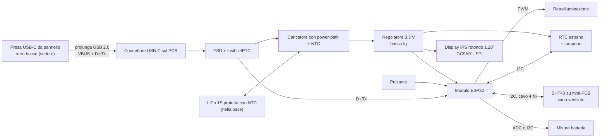

# 02 — Architettura hardware

**Versione:** 0.3 · **Stato:** architettura PCB custom candidata, non validata · **Data:** 2026-11-07

## 1. Strategia

La V1 usa un **PCB custom progettato in KiCad e prodotto/assemblato da JLCPCB** (`DEC-015`), con il minimo indispensabile per le funzioni richieste. La scheda integrata Waveshare ESP32-S3-Touch-AMOLED-1.75 (ex `CAND-001`) è stata scartata per costo e per i componenti superflui (audio, microSD, IMU).

Il PCB custom **non** è più economico per un solo esemplare (costi fissi di assemblaggio, spedizione, possibile seconda revisione): la scelta è motivata da forma su misura, controllo dei consumi e sicurezza della ricarica.

Per ridurre il rischio di una revisione PCB sbagliata, prima del disegno si valida l'architettura **su banco con moduli commerciali economici** (dev board ESP32, modulo display GC9A01, breakout di carica e SHT40): vedi [roadmap](09-roadmap.md), M1.

Non confondere la disponibilità di una funzione nel datasheet con il suo corretto funzionamento nel nostro montaggio.

## 2. Schema a blocchi

Il diagramma descrive funzioni logiche: non sostituisce lo schema elettrico KiCad.

## 3. Blocchi funzionali e candidati

Tutti i codici sono **CAND**: da verificare su datasheet, disponibilità e prezzo LCSC/JLCPCB (preferire parti "basic" per ridurre i costi fissi di assemblaggio).

| Blocco | Funzione | Requisiti | Candidati (CAND) |
|---|---|---|---|
| MCU | Logica, UI, gestione energia | Supporto ESP-IDF, USB nativa per flash/log via USB-C, light-sleep, SPI + I²C + ADC + PWM, GPIO di risveglio per il pulsante | Modulo **ESP32-C3-MINI-1** (consigliato: sufficiente per 240×240 e più economico) o ESP32-S3-MINI-1. Modulo certificato con antenna/flash integrate, non chip nudo |
| Display | Volto | Rotondo, IPS, **1,28"**, **240×240**, driver **GC9A01**, SPI 4 fili (`DEC-016`) | Pannello nudo con FPC su connettore del PCB; pinout, alimentazione e retroilluminazione dal datasheet del pannello acquistato |
| Retroilluminazione | DIM/BRIGHT/NIGHT | Regolabile via PWM, spegnibile del tutto di notte | MOSFET/transistor + resistenza, valori dal datasheet del pannello |
| Interazione | Accendere/impostare | **Pulsante** fisico (`DEC-017`), posizione da definire | Pulsante tattile su PCB o remoto via cavo; pull-up e antirimbalzo; GPIO capace di risvegliare il chip |
| Touch (predisposto) | Opzione futura (`DEC-019`) | Controller touch del pannello su I²C condiviso + **INT** (GPIO con risveglio) + **RST**; connettore FPC/footprint previsto, componenti non montati se non serve | Controller tipico dei pannelli 1,28" (es. famiglia CST816), da confermare sul datasheet del pannello |
| USB dati | Flash, log e **configuratore** (`DEC-020`) | D+/D- dalla USB-C alla USB nativa dell'MCU secondo le design guideline Espressif; ESD; nessun convertitore esterno | La USB Serial/JTAG dell'ESP32-C3/S3 compare al PC come porta seriale |
| USB | Ricarica e programmazione | USB-C ricettacolo 2.0, resistenze CC 5,1 kΩ, protezione ESD, fusibile/PTC su VBUS | Ricettacolo USB-C 16 pin; ESD tipo USBLC6-2 |
| Caricatore | Ricarica sicura | **Power-path** (funzionamento con USB collegata, `DEC-008`), ingresso **NTC cella**, corrente di carica impostabile in modo prudente, 4,2 V | BQ24074 (TI) o equivalente con power-path e TS; da confermare |
| Regolatore 3,3 V | Alimentare MCU, display, sensori | Bassa corrente di riposo; picchi MCU gestiti; comportamento con batteria a 3,0–3,4 V | LDO a basso dropout e bassa Iq, oppure buck-boost (es. TPS63802) se serve sfruttare la cella fino in fondo |
| RTC | Ora anche con scarica completa | Bassissimo consumo, alimentazione tampone (supercondensatore o pila a bottone), I²C | RV-3028-C7 (Micro Crystal) o PCF85063A con tampone |
| Misura batteria | Livelli batteria | Niente percentuali inventate | Partitore commutato su ADC (minimo) oppure fuel gauge I²C (es. MAX17048) |
| Sensore T/RH | Misure ambiente | **SHT40** su mini-PCB dedicato, senza LED, collegato con 4 fili | Mini-PCB nello stesso pannello JLC del PCB principale |
| Connettori | Batteria, SHT40, pulsante remoto | Polarizzati, con ritenuta, polarità serigrafata | JST-PH 2,0 o JST-SH 1,0 (da scegliere in base alla batteria) |
| Debug | Bring-up | Punti di test su VBUS, VBAT, 3,3 V, GND; tasti BOOT/RESET o pad equivalenti | — |

## 4. Sensore temperatura/umidità

**Sensirion SHT40** è la scelta candidata. Specifica tipica: ±1,8 %RH; la temperatura ha accuratezza tipica dichiarata dal costruttore in condizioni specificate dal datasheet. Vedere [pagina prodotto](https://sensirion.com/products/catalog/SHT40).

- Montato su un **mini-PCB** prodotto insieme al PCB principale: niente LED, niente regolatore, pull-up I²C sul PCB principale.
- Posizionamento **separato fisicamente** dalle sorgenti di calore (MCU, caricatore, retroilluminazione, batteria), con feritoie verso l'aria ambiente.
- Cavo a 4 fili con connettore polarizzato e fermacavo.
- Indirizzo tipico `0x44`: verificare assenza di conflitti con RTC e fuel gauge scelti.
- Campionamento iniziale consigliato **30–60 s** (parametro firmware).

## 5. Scelte intenzionalmente escluse

Non servono per V1: audio, microSD, IMU, GPS, touch montato (solo predisposto, `DEC-019`), sensore CO₂, sensore luce, Wi-Fi/BLE (`DEC-012`), convertitore USB-seriale esterno (la USB nativa dell'ESP32 basta), secondo caricabatterie in parallelo.

## 6. Interfacce e verifiche prima dell'ordine PCB

| Interfaccia | Uso previsto | Verifica obbligatoria |
|---|---|---|
| USB-C + prolunga | Alimentazione, ricarica, flashing/log | Prolunga con linee dati USB 2.0; enumerazione USB attraverso la prolunga provata su banco |
| Batteria | LiPo 1S protetta | **Polarità** del connettore scelto contro quella della cella; NTC della cella compatibile con il caricatore |
| Display | GC9A01 via SPI | Pinout FPC, tensioni, corrente retroilluminazione dal datasheet del pannello **acquistato** |
| I²C | RTC, SHT40, eventuale fuel gauge | Indirizzi, pull-up unici, lunghezza cavo SHT40 |
| Pulsante | Risveglio/illuminazione UI | Risveglio da light-sleep provato sulla dev board |
| Touch (predisposto) | Opzione futura | Pinout FPC del pannello scelto; GPIO INT/RST liberi e con risveglio (`OPEN-019`); prova con modulo touch in M1 |
| USB dati / configuratore | Impostazioni da PC | Porta seriale visibile e comandi funzionanti **attraverso la prolunga**, anche dopo light-sleep (verificare il comportamento della USB nativa durante la sospensione) |
| RTC | Unica fonte di tempo in V1 | Mantenimento con LiPo scollegata grazie al tampone |

## 7. Alternative e rischi

- **Prima revisione PCB con errori**: probabile. Mitigazione: prototipo su banco con moduli (M1), revisione schema con checklist, punti di test, jumper/resistenze 0 Ω per isolare i blocchi.
- **Pannello display senza datasheet affidabile**: acquistare un pannello di cui sia disponibile il datasheet con pinout FPC prima di disegnare il connettore.
- **Componenti non disponibili a JLC**: verificare disponibilità LCSC prima del layout; prevedere alternative compatibili a pin.
- **Alternativa economica pronta**: schede commerciali con ESP32 e display rotondo 1,28" integrato restano un piano B se il PCB custom fallisce o si blocca.
- **Dimensioni**: diametro attivo del pannello 1,28" circa 32 mm (da verificare sul datasheet); il PCB rotondo dietro il display determina il diametro interno minimo della testa.

## 8. Gate di conferma hardware

Il PCB diventa `APPROVATO` solo dopo: revisione schema e layout (ERC/DRC puliti, checklist), bring-up delle alimentazioni con limitazione di corrente, flash via USB attraverso la prolunga, display e pulsante funzionanti, lettura SHT40 e RTC, prova carica/scarica con la cella scelta e cutoff NTC verificato, misura dell'assorbimento in DIM, BRIGHT, NIGHT e spento.
