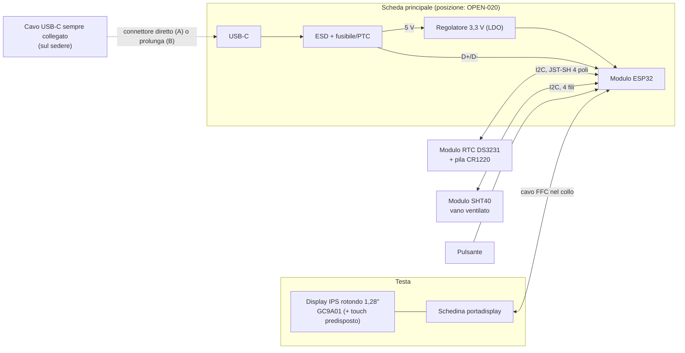
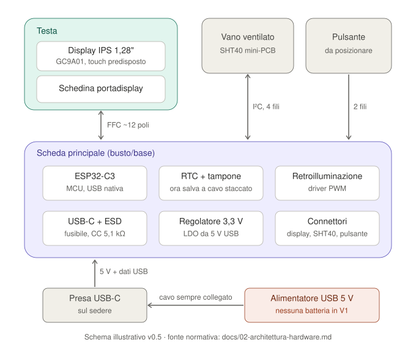

# 02 — Architettura hardware

**Versione:** 0.6 · **Stato:** architettura PCB custom candidata, schema rev 0.1 disegnato, non validato · **Data:** 2026-11-07

## 1. Strategia

La V1 usa un **PCB custom progettato in KiCad e prodotto/assemblato da JLCPCB** (`DEC-015`), con il minimo indispensabile per le funzioni richieste. La scheda integrata Waveshare ESP32-S3-Touch-AMOLED-1.75 (ex `CAND-001`) è stata scartata per costo e per i componenti superflui.

L'elettronica è divisa in **schede separate** (`DEC-021`):

1. **Scheda principale** rettangolare, **separata dal display**: MCU, protezioni USB, regolatore 3,3 V, USB-C, connettori (incluso quello del modulo RTC esterno, `DEC-024`). **Nessuna batteria** nella V1 (`DEC-023`). Posizione nella statuetta da decidere con la bozza CAD (busto/base o testa, `OPEN-020`).
2. **Schedina portadisplay** rotonda nella testa: solo il connettore del pannello, i condensatori di disaccoppiamento e il connettore del cavo verso la scheda principale.
3. **Modulo breakout SHT40** commerciale nel vano ventilato, collegato via cavo (`DEC-028`): non è un PCB custom.
4. **Modulo RTC esterno** Adafruit DS3231 STEMMA QT con pila CR1220, collegato via cavo JST-SH 4 poli (`DEC-024`): non è un PCB custom.

Scheda principale e portadisplay sono collegate da un **cavo piatto FFC 16 poli passo 0,5 mm** che attraversa il collo (`DEC-026`). Tutte le schede si ordinano nello **stesso pannello JLC**.

Il PCB custom **non** è più economico per un solo esemplare (costi fissi di assemblaggio, spedizione, possibile seconda revisione): la scelta è motivata da controllo del progetto, minimo indispensabile e integrazione nella statuetta.

Per ridurre il rischio di una revisione sbagliata, prima del disegno si valida l'architettura **su banco con moduli commerciali economici**, con cavi display della stessa lunghezza prevista (vedi [roadmap](09-roadmap.md), M1).

Non confondere la disponibilità di una funzione nel datasheet con il suo corretto funzionamento nel nostro montaggio.

## 2. Schema a blocchi

Il diagramma descrive funzioni logiche: non sostituisce lo schema elettrico KiCad.

## 3. Blocchi funzionali e candidati

Tutti i codici sono **CAND**: da verificare su datasheet, disponibilità e prezzo LCSC/JLCPCB (preferire parti "basic" per ridurre i costi fissi di assemblaggio).

| Blocco | Funzione | Requisiti | Candidati (CAND) |
|---|---|---|---|
| MCU | Logica, UI | Supporto ESP-IDF, USB nativa per flash/log/configuratore, SPI + I²C + PWM, GPIO per pulsante e touch | Modulo **ESP32-C3-MINI-1** (consigliato) o ESP32-S3-MINI-1; modulo certificato con antenna/flash integrate |
| Display | Volto | Rotondo, IPS, **1,28"**, **240×240**, driver **GC9A01**, SPI 4 fili (`DEC-016`) | Pannello nudo con FPC, disponibile con e senza touch (`DEC-019`) |
| Portadisplay | Interfaccia pannello ↔ cavo | Connettore FPC del pannello, condensatori vicino al pannello, connettore del cavo; sagoma e fori per il fissaggio nella testa | Schedina rotonda a 2 strati, nessun componente attivo |
| Collegamento display | Testa ↔ scheda principale | **16 conduttori**: 2×3,3 V, 4×GND alternati ai segnali, SCLK, MOSI, CS, DC, RST, LEDK; touch: SDA, SCL, INT, RST. Lunghezza indicativa 5–15 cm | **FFC 16 poli passo 0,5 mm**, connettori ZIF JUSHUO AFC01-S16FCA-00 (`DEC-026`); SPI a **10–20 MHz** da validare in M1 (`OPEN-021`) |
| Retroilluminazione | DIM/BRIGHT/NIGHT | PWM, spegnibile del tutto di notte | MOSFET AO3400A lato basso su LEDK + resistenza R18 (TBD dal datasheet del pannello, `OPEN-024`) |
| Interazione | Accendere/impostare | **Pulsante** fisico (`DEC-017`), posizione da definire | Connettore JST-SH 2 poli per pulsante remoto + tasto su scheda in parallelo (`DEC-027`); pull-up 10 kΩ e 100 nF; IO3 con risveglio |
| Touch (predisposto) | Opzione futura (`DEC-019`) | Controller del pannello su I²C + **INT** (GPIO con risveglio) + **RST** portati nel cavo; componenti non montati se non serve | CST816S del pannello touch 18 poli (`DEC-025`); I²C collegato solo montando R11/R12 0 Ω (DNP) |
| USB | **Alimentazione**, flash, configuratore (`DEC-020`, `DEC-023`) | USB-C 2.0, CC 5,1 kΩ, ESD, fusibile/PTC; D+/D- alla USB nativa dell'MCU secondo le design guideline Espressif | Ricettacolo USB-C sulla scheda principale; ESD tipo USBLC6-2 |
| Regolatore 3,3 V | Alimentare MCU, display, sensori da 5 V USB | Corrente massima con margine sui picchi MCU (il modulo richiede una sorgente ≥ 0,5 A); dissipazione accettabile | LDO **AMS1117-3.3** (Basic) (`CAND-015`, `OPEN-025`) |
| RTC | Ora anche a cavo scollegato | Tampone che copra almeno alcuni giorni, I²C, buona precisione (nessun NTP) | **Modulo esterno Adafruit DS3231 STEMMA QT** + pila CR1220 su connettore JST-SH 4 poli (`DEC-024`) |
| Sensore T/RH | Misure ambiente | **SHT40**, 4 fili, lontano dalle sorgenti di calore | **Modulo breakout SHT40** commerciale con header 2,54 mm, alimentato a 3,3 V da J3 (`DEC-028`) |
| Connettori | SHT40, RTC, pulsante | Polarizzati, con ritenuta, polarità serigrafata | **JST-SH 1,0 mm**: 4 poli con pinout Qwiic/STEMMA QT per SHT40 (cavo JST-SH → jumper femmina) e RTC, 2 poli per il pulsante |
| Debug | Bring-up | Punti di test VBUS, 5 V protetto, 3,3 V, GND, EN, UART TX, I²C; tasti BOOT/RESET; resistenze 0 Ω per isolare LDO, display e moduli esterni | — |

**Budget dei pin (ESP32-C3):** SPI display 5, retroilluminazione 1, I²C 2, touch INT/RST 2, pulsante 1, USB 2, BOOT 1: 14 GPIO sui 15 del modulo; IO21 (TXD0) resta su un punto di test. Verificato sul datasheet ESP32-C3-MINI-1 v2.2, strapping inclusi (`CAND-023`).

### 3.1 Assegnazione dei pin (schema rev 0.1)

| GPIO | Pin modulo | Segnale | Note |
|---|---:|---|---|
| IO0 | 12 | TP_INT | Touch predisposto; risveglio da deep-sleep (GPIO0–5) |
| IO1 | 13 | TP_RST | Touch predisposto |
| IO2 | 5 | I2C_SDA | Strapping: pull-up 4,7 kΩ raccomandato da Espressif |
| IO3 | 6 | BTN_USER | Attivo basso, pull-up 10 kΩ, risveglio da deep-sleep |
| IO4 | 18 | LCD_DC | |
| IO5 | 19 | LCD_RST | Pull-up 10 kΩ |
| IO6 | 20 | LCD_SCLK | IO_MUX FSPICLK, 22 Ω in serie |
| IO7 | 21 | LCD_MOSI | IO_MUX FSPID, 22 Ω in serie |
| IO8 | 22 | I2C_SCL | Strapping: = 1 per il download, pull-up 4,7 kΩ |
| IO9 | 23 | BOOT | Strapping: pull-up 10 kΩ + tasto BOOT |
| IO10 | 16 | LCD_CS | IO_MUX FSPICS0 |
| IO18 / IO19 | 26 / 27 | USB D- / D+ | USB Serial/JTAG nativa |
| IO20 (RXD0) | 30 | LCD_BL | PWM retroilluminazione; gate con pull-down 100 kΩ |
| IO21 (TXD0) | 31 | UART_TX | Punto di test |

Bus I²C condiviso: SHT40 `0x44`, DS3231 `0x68`, touch CST816S `0x15` (indirizzo da confermare sul datasheet). Dettagli e codici LCSC in [12 — Selezione componenti](12-selezione-componenti.md).

## 4. Collegamento display su cavo

- Il SPI del GC9A01 su un cavo di qualche centimetro è affidabile se: frequenza moderata (10–20 MHz iniziali), **masse alternate** ai segnali veloci (soprattutto SCLK), eventuali resistenze serie di smorzamento vicino all'MCU, condensatori di disaccoppiamento **sul portadisplay**.
- A 20 MHz un'immagine completa 240×240 a 16 bit (circa 115 kB) richiede circa 50 ms: più che sufficiente per un orologio che aggiorna il minuto.
- La retroilluminazione è la corrente maggiore che passa nel cavo: dimensionare i conduttori di alimentazione (più pin in parallelo se necessario).
- Il cavo deve piegarsi nel collo senza tensione sui connettori; fissarlo con fermacavo.

## 5. Sensore temperatura/umidità

**Sensirion SHT40** è la scelta candidata. Specifica tipica: ±1,8 %RH; la temperatura ha accuratezza tipica dichiarata dal costruttore in condizioni specificate dal datasheet. Vedere [pagina prodotto](https://sensirion.com/products/catalog/SHT40).

- Montato su un **modulo breakout commerciale** (`DEC-028`), alimentato a **3,3 V** dal connettore J3 della scheda principale. Questi moduli hanno spesso regolatore, pull-up e a volte un LED: se c'è un LED, va rimosso o disattivato per non scaldare il sensore. I pull-up del modulo sono in parallelo a quelli da 4,7 kΩ della scheda principale.
- Collegamento: cavo JST-SH 4 poli (lato scheda) → jumper femmina 2,54 mm (lato modulo), oppure fili saldati sul modulo; l'ordine dei pin va letto sulla **serigrafia del modulo acquistato** (`OPEN-002`).
- Posizionamento **separato fisicamente** dalle sorgenti di calore (scheda principale, regolatore, retroilluminazione), con feritoie verso l'aria ambiente.
- Cavo a 4 fili con connettore polarizzato e fermacavo.
- Indirizzo `0x44` (SHT40-AD1B): nessun conflitto con RTC DS3231 (`0x68`) e touch (`0x15`).
- Campionamento iniziale consigliato **30–60 s** (parametro firmware).

## 6. Scelte intenzionalmente escluse

Non servono per V1: audio, microSD, IMU, GPS, touch montato (solo predisposto, `DEC-019`), sensore CO₂, sensore luce, Wi-Fi/BLE (`DEC-012`), convertitore USB-seriale esterno, batteria e circuiti di carica (`DEC-023`).

## 7. Interfacce e verifiche prima dell'ordine PCB

| Interfaccia | Uso previsto | Verifica obbligatoria |
|---|---|---|
| USB-C | Alimentazione continua, flash, configuratore | Opzione A: connettore sul bordo della scheda allineato al foro sul sedere. Opzione B: enumerazione attraverso la prolunga provata su banco |
| Display su cavo | GC9A01 via SPI | Pinout FPC dal datasheet del pannello **acquistato**; prova su banco con cavo di lunghezza reale e frequenza scelta |
| I²C | RTC (modulo esterno), SHT40, touch | Indirizzi; pull-up 4,7 kΩ sulla scheda in parallelo ai 10 kΩ del modulo DS3231; lunghezze dei cavi |
| Pulsante | Illuminazione UI e menu | Antirimbalzo e pressione breve/lunga provati sulla dev board |
| Touch (predisposto) | Opzione futura | Pinout touch del pannello acquistato; GPIO INT/RST proposti IO0/IO1 (`OPEN-019`) |
| USB dati / configuratore | Impostazioni da PC | Porta seriale e comandi funzionanti in tutti i modi (DIM/BRIGHT/NIGHT) |
| RTC | Unica fonte di tempo in V1 | Modulo DS3231 su J4; mantenimento a cavo scollegato con la pila CR1220; deriva misurata |

## 8. Alternative e rischi

- **Prima revisione PCB con errori**: probabile. Mitigazione: prototipo M1, revisione schema con checklist, punti di test, 0 Ω/jumper per isolare i blocchi, revisione visiva del proprietario in KiCad.
- **Disturbi sul cavo display**: frequenza SPI ridotta, masse alternate, prova su banco con cavo reale.
- **Pannello senza datasheet affidabile**: acquistare solo pannelli con pinout FPC documentato.
- **Componenti non disponibili a JLC**: verificare LCSC prima del layout; alternative compatibili a pin (già successo con l'RV-3028-C7, `DEC-024`).
- **Spazio nel busto insufficiente** per la scheda: decidere la posizione con la bozza Blender (`OPEN-020`).
- **Piano B**: schede commerciali con ESP32 e display rotondo 1,28" integrato.

## 9. Gate di conferma hardware

Il PCB diventa `APPROVATO` solo dopo: revisione schema e layout (ERC/DRC puliti, checklist, revisione visiva del proprietario in KiCad), bring-up delle alimentazioni con limitazione di corrente, flash e configuratore via USB-C posteriore, display stabile sul cavo reale, pulsante, lettura SHT40 e RTC, protezioni dell'ingresso USB verificate, durata del tampone RTC, misura dell'assorbimento in DIM, BRIGHT, NIGHT e temperature in funzionamento continuo.
