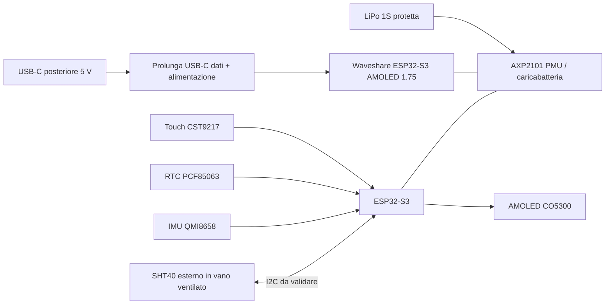

# 02 — Architettura hardware

**Versione:** 0.1 · **Stato:** soluzione candidata, non validata · **Data:** 2026-11-07

## 1. Strategia

Per il primo prototipo **non** progettare immediatamente un PCB nuovo. Utilizzare un modulo ESP32/display integrato per ridurre cablaggi, rischi di integrazione e tempi di avvio. Non confondere la disponibilità di una funzione nella documentazione del produttore con il suo corretto funzionamento nel nostro montaggio.

## 2. Scheda candidata principale

**Waveshare ESP32-S3-Touch-AMOLED-1.75**, variante standard **SKU 31261** (non le versioni B con custodia o G con GPS, salvo cambi motivati).

Caratteristiche **documentate dal produttore**:

| Blocco | Specifica dichiarata |
|---|---|
| MCU | ESP32-S3R8, dual core, fino a 240 MHz; Wi-Fi 2,4 GHz / BLE |
| Memoria | 8 MB PSRAM, 16 MB flash esterna |
| Display | AMOLED touch **1,75 pollici**, **466×466**, driver **CO5300**, bus QSPI |
| Touch | Capacitivo **CST9217** tramite I²C |
| RTC | **PCF85063** |
| PMU/carica | **AXP2101** |
| Movimento | IMU **QMI8658** (accelerometro + giroscopio) |
| Batteria | Presa 2 pin **MX1.25**, batteria nominale **3,7 V** |
| Audio | Codec **ES8311**, ADC/eco **ES7210** con doppio microfono, amplificatore **NS4150B**, presa altoparlante MX1.25 (altoparlante 8 Ω 2 W incluso) |
| Altro | Espansore I/O **TCA9554**, slot **microSD**, tasti PWR e BOOT |
| Interfacce | USB-C nativa; intestazione 8 pin passo 2,54 mm (3 GPIO + 1 UART) e pad riservati I²C/IO |

Fonti: [manuale Waveshare](https://docs.waveshare.com/ESP32-S3-Touch-AMOLED-1.75), [pagina prodotto](https://www.waveshare.com/product/esp32-s3-touch-amoled-1.75.htm) e [risorse hardware ufficiali](https://docs.waveshare.com/ESP32-S3-Touch-AMOLED-1.75/Resources-And-Documents).

Audio, microfoni, microSD e IMU non servono alla V1: il firmware deve mantenerli **disattivati/non alimentati** dove possibile e la loro corrente residua va misurata.

### 2.1 Rilievi dallo schematico ufficiale (PDF datato 2025-07-28, da riconfermare sulla revisione acquistata)

| Punto | Rilievo | Conseguenza |
|---|---|---|
| Bus I²C principale | `ESP32_SDA` = GPIO15, `ESP32_SCL` = GPIO14, pull-up 2,2 kΩ verso 3,3 V già presenti | SHT40 collegabile sul bus esistente senza pull-up aggiuntivi (`CAND-011`) |
| Indirizzi leggibili sullo schema | QMI8658 `0x6B`, ES7210 `0x40` | Nessun conflitto con l'indirizzo tipico SHT40 `0x44`; gli altri dispositivi vanno confermati con scan I²C |
| Header H2 (8 pin) | VBUS, GND, 3,3 V, U0RXD, U0TXD, GPIO16, GPIO17, GPIO18 | Alternativa: secondo bus I²C su GPIO17/18 se i pad riservati sono scomodi |
| Pin TS dell'AXP2101 | Collegato a un **termistore 10 kΩ montato sulla scheda** | La carica non sorveglia la temperatura **della cella** (`OPEN-013`) |
| RTC PCF85063 | Alimentato da `VCC-RTC` dell'AXP2101, nessuna batteria tampone dedicata | Con cella scarica/protezione intervenuta l'ora può andare persa (`OPEN-014`) |
| Touch | Interrupt `TP_INT` su GPIO11 | Possibile sorgente di risveglio da light-sleep, da provare |

**Da verificare sulla scheda acquistata:** revisione dello schematico, accessibilità fisica dei pad, polarità reale del connettore batteria, capacità di risveglio touch, dimensioni PCB e supporto USB tramite prolunga.

## 3. Schema a blocchi funzionale

Il diagramma descrive funzioni logiche: **non** sostituisce lo schema elettrico o la verifica del percorso di carica sulla scheda.

## 4. Sensore temperatura/umidità

**Sensirion SHT40** (modulo breakout I²C a basso consumo) è la scelta candidata. Specifica tipica: ±1,8 %RH; la temperatura ha accuratezza tipica dichiarata dal costruttore in condizioni specificate dal datasheet. Vedere [pagina prodotto](https://sensirion.com/products/catalog/SHT40).

Scegliere un breakout **senza LED di alimentazione** (o con LED rimovibile) e senza regolatori non necessari: il LED consuma corrente e scalda proprio il sensore.

Requisiti di integrazione:

- Posizionamento **separato fisicamente** dai principali dissipatori di calore, preferibilmente con feritoie verso aria ambiente.
- Alimentazione e pull-up I²C compatibili con la scheda; **non** collegare senza aver verificato i livelli di tensione.
- Verifica degli indirizzi I²C di tutti i dispositivi e delle resistenze di pull-up equivalenti.
- Connettore/cavo con fermacavo, non fili saldati lasciati liberi nella cavità.
- Velocità di campionamento iniziale consigliata **30–60 s** (parametro firmware, non vincolo del sensore).

## 5. Scelte intenzionalmente escluse

Non servono per V1: DFPlayer, altoparlanti, microfoni, GPS, SD card, modulo RTC DS3231, sensore CO₂, sensore luce, Wi-Fi/BLE (`DEC-012`) e convertitore USB-seriale esterno (salvo necessità di debug). L'altoparlante incluso nella confezione non va montato. I componenti già presenti sulla scheda ma non usati non devono diventare dipendenze software.

## 6. Interfacce e verifiche preordine

| Interfaccia | Uso previsto | Verifica obbligatoria |
|---|---|---|
| USB-C | Alimentazione, ricarica, flashing/log | Prolunga compatibile USB 2.0 dati, orientamento, spazio e serraggio |
| Batteria MX1.25 | LiPo 1S | **Polarità reale**, connettore, tensione, parametri carica, presenza protezioni |
| I²C | SHT40 + periferiche integrate | Pad accessibili, indirizzi, 3,3 V, bus length/capacitance |
| Touch | Risveglio/illuminazione UI | Evento realmente disponibile nello stato di risparmio energetico |
| RTC | Timekeeping offline (unica fonte di tempo in V1) | Comportamento in spegnimento PMU, batteria bassa/rimossa e dopo intervento protezione cella |
| IMU | Potenziale gesto di attivazione V2 | Non necessaria per V1; non abilitarla se aumenta i consumi |

## 7. Alternative e rischi

- **AMOLED integrato**: riduce cablaggio ma incorpora anche audio/SD non necessari e può rendere complessi i consumi minimi.
- **Display TFT IPS + ESP32 separato**: piano B se AMOLED e dimensioni/power budget non sono adatti; richiede più cablaggio e backlight sempre alimentata.
- **Dimensioni**: il diametro di 1,75" non equivale al diametro esterno del PCB; il CAD deve utilizzare la tavola tecnica e misure effettive.
- **I²C condiviso**: possibili collisioni o mancanza di pin accessibili. Fermare gli acquisti se lo schema del produttore non consente un collegamento affidabile.

## 8. Gate di conferma hardware

Il modulo diventa `APPROVATO` solo dopo: foto e misure del componente reale; bring-up di display e touch; acquisizione SHT40 senza conflitti; verifica del percorso USB-C; prova carica/scarica con cella selezionata; misura dell'assorbimento in almeno tre stati (dim, bright, power off).
