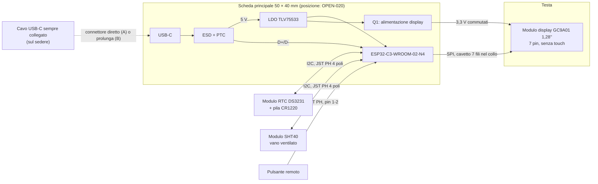

# 02 — Architettura hardware

**Versione:** 0.9 · **Stato:** schema e PCB rev 0.2 della scheda principale in bozza (dopo la revisione tecnica indipendente), non validati · **Data:** 2026-11-08

## 1. Strategia

La V1 usa un **PCB custom progettato in KiCad e prodotto/assemblato da JLCPCB** (`DEC-015`), con il minimo indispensabile per le funzioni richieste, nel rispetto delle **regole di fabbricazione e assemblaggio JLCPCB** (vincolo `SC-008`, `DEC-040`, `PR-REL-008`).

Dalla rev 0.2 c'è **un solo PCB custom**, la scheda principale. Tutto il resto sono **moduli commerciali** collegati con cavetti:

1. **Scheda principale** 50 × 40 mm (`DEC-036`): MCU, protezioni USB, regolatore 3,3 V, USB-C, connettori. **Nessuna batteria** (`DEC-023`, riconfermata in `DEC-038`). Posizione nella statuetta da decidere con la bozza CAD (`OPEN-020`, studio volumetrico `OPEN-028`).
2. **Modulo display GC9A01 1,28" a 7 pin** (`DEC-034`): IPS a colori 240×240 su schedina con piedini 2,54 mm, provabile su breadboard; senza touch. Sostituisce pannello nudo, schedina portadisplay e cavo FFC della rev 0.1.
3. **Modulo breakout SHT40** nel vano ventilato (`DEC-028`).
4. **Modulo RTC Adafruit DS3231 STEMMA QT** con pila CR1220 (`DEC-024`).

Il PCB custom **non** è più economico per un solo esemplare (costi fissi di assemblaggio, spedizione, possibile seconda revisione): la scelta è motivata da controllo del progetto, minimo indispensabile e integrazione nella statuetta. Stima dei costi in [08](08-bom-preliminare.md) §8.

Prima dell'ordine si valida l'architettura **su banco con i moduli commerciali** (vedi [roadmap](09-roadmap.md), M1). Non confondere la disponibilità di una funzione nel datasheet con il suo corretto funzionamento nel nostro montaggio.

## 2. Schema a blocchi

Il diagramma descrive funzioni logiche: non sostituisce lo schema elettrico KiCad.

## 3. Blocchi funzionali

Componenti e codici LCSC in [12 — Selezione componenti](12-selezione-componenti.md); tutti `CAND` fino al prototipo M1.

| Blocco | Funzione | Requisiti | Soluzione (rev 0.2) |
|---|---|---|---|
| MCU | Logica, UI | ESP-IDF, USB nativa per flash/log/configuratore, SPI + I²C | **ESP32-C3-WROOM-02-N4** (`DEC-044`, supera `DEC-035`): assemblaggio JLC "Economic" senza radiografia; chip v0.4, supportato da ESP-IDF v6.0/v6.1 (revisione minima predefinita v0.3); 18 × 20 × 3,2 mm, 19 pin con EPAD |
| Display | Volto | Rotondo, IPS, **1,28"**, 240×240, GC9A01, SPI 4 fili (`DEC-016`) | **Modulo a 7 pin** (VCC, GND, SCL, SDA, DC, CS, RST), senza touch e senza pin per la retroilluminazione (`DEC-034`) |
| Collegamento display | Testa ↔ scheda principale | 7 conduttori, lunghezza dal CAD | Header maschio 1×7 2,54 mm a foro passante a 90° (J2, saldato a mano, `DEC-043`) + cavetto Dupont femmina-femmina dritto; R8/R9 22 Ω in serie su SCLK/MOSI; SPI 10–20 MHz da provare (`OPEN-021`) |
| Display: notte e luminosità | DIM/BRIGHT/NIGHT | Display spento di notte (`DEC-009`) | P-MOS **AO3401A** (Q1) sull'alimentazione del modulo, comandato da IO20; DIM/BRIGHT solo con i colori della grafica (retroilluminazione fissa, `DEC-034`) |
| Interazione | Accendere/impostare | **Pulsante** fisico (`DEC-017`) | Pulsante remoto su J5, JST PH 4 poli usato sui pin 1–2 (`DEC-032`, `DEC-043`); pull-up 10 kΩ e 100 nF; IO3 con risveglio |
| USB | **Alimentazione**, flash, configuratore (`DEC-020`, `DEC-023`) | USB-C 2.0, CC 5,1 kΩ, ESD, PTC | TYPE-C-31-M-12 (footprint KiCad dal disegno HRO), USBLC6-2SC6 a passaggio diretto vicino al connettore, coppia D+/D- simmetrica tracciata a mano (`DEC-041`), PTC 0,5 A |
| Regolatore 3,3 V | Alimentare MCU, display e moduli | ≥ 0,5 A (richiesta Espressif), stabile con condensatori ceramici | **TLV75533** 500 mA (`DEC-037`), condensatori a 2,2–2,4 mm dai pin |
| Reset e boot | Flash e recupero | EN con RC, strapping IO9 | Nessun tasto (`DEC-039`): RC 10 kΩ/1 µF su EN, pull-up 10 kΩ su IO9, punti di test TP6 (EN) e TP11 (IO9) vicino ai pin |
| RTC | Ora anche a cavo scollegato | Tampone e precisione senza NTP | Modulo esterno DS3231 su J4 (`DEC-024`) |
| Sensore T/RH | Misure ambiente | SHT40 lontano dal calore | Modulo breakout su J3 (`DEC-028`) |
| Connettori | SHT40, RTC, pulsante | Polarizzati, con ritenuta | **JST PH 2,0 mm B4B-PH-K-S** verticali a foro passante, saldati a mano (`DEC-043`): 1 GND, 2 3V3, 3 SDA, 4 SCL; J5 usa i pin 1–2 (3–4 non collegati) |
| Debug | Bring-up | Punti di test, isolamento dei blocchi | 11 punti di test sul retro con etichetta; resistenze 0 Ω per isolare il regolatore e i moduli esterni |

**Budget dei pin (ESP32-C3):** SPI display 4 + RST 1, alimentazione display 1, I²C 2, pulsante 1, USB 2, BOOT 1: 12 GPIO; IO0 e IO1 liberi su punti di test, IO21 (TXD0) su punto di test. Verificato sul datasheet ESP32-C3-WROOM-02 v1.7 (tab. 3-1 e 4-1), strapping inclusi.

### 3.1 Assegnazione dei pin (schema rev 0.2)

| GPIO | Pin modulo | Segnale | Note |
|---|---:|---|---|
| IO0 / IO1 | 18 / 17 | liberi | TP9/TP10 |
| IO2 | 16 | I2C_SDA | Strapping: pull-up 4,7 kΩ raccomandato da Espressif (prova di boot `VT-PCB-004`) |
| IO3 | 15 | BTN_USER | Attivo basso, pull-up 10 kΩ, risveglio da deep-sleep |
| IO4 | 3 | LCD_DC | |
| IO5 | 4 | LCD_RST | Pull-up 10 kΩ verso 3V3_DISP |
| IO6 | 5 | LCD_SCLK | IO_MUX FSPICLK, 22 Ω in serie |
| IO7 | 6 | LCD_MOSI | IO_MUX FSPID, 22 Ω in serie |
| IO8 | 7 | I2C_SCL | Strapping: = 1 per il download, pull-up 4,7 kΩ |
| IO9 | 8 | BOOT | Strapping: pull-up 10 kΩ; TP11 per forzare il download |
| IO10 | 10 | LCD_CS | IO_MUX FSPICS0 |
| IO18 / IO19 | 13 / 14 | USB D- / D+ | USB Serial/JTAG nativa |
| IO20 (RXD) | 11 | DISP_EN_N | Basso = display alimentato; R17 tiene il display spento al boot |
| IO21 (TXD) | 12 | UART_TX | Punto di test TP5 |

Pin del modulo ESP32-C3-WROOM-02 (`DEC-044`, datasheet v1.7 tab. 3-1): 3V3 = 1, EN = 2, GND = 9 e 19 (EPAD). Con il MINI-1 i numeri erano diversi (IO18/IO19 = 26/27); i GPIO e i segnali non cambiano.

Bus I²C condiviso: SHT40 `0x44`, DS3231 `0x68`.

*(Lo schema a blocchi illustrativo in `assets/` precede la rev 0.2: il display è ora un modulo a 7 pin senza schedina portadisplay.)*

### 3.2 PCB della scheda principale rev 0.2 (2026-11-08)

File: `hardware/policlock-main/policlock-main.kicad_pcb` (render, PDF, BOM, CPL e STEP nella stessa cartella). **Bozza completa**: posizionamento e sbroglio automatico con Freerouting, rivisto e approvato a vista dal proprietario il 2026-11-08 (`OPEN-027` chiusa).

| Parametro | Valore | Motivazione |
|---|---|---|
| Dimensioni scheda | **50 × 40 mm**, con **intaglio** di circa 8,5 × 20,2 mm nell'angolo in alto a destra (da x = 41,51 mm, inizio dell'antenna del WROOM-02, `DEC-044`) | `DEC-036` ("per il primo prototipo è meglio stare larghi e confermare 50x40"). Lo sbroglio completo con le regole JLC è riuscito a 50 × 40, senza bisogno di ingrandire |
| Ingombro totale | **50 × 40 mm**; oltre il contorno sporgono solo i **piedini dell'header display (~5,7 mm sopra il bordo superiore)** e il guscio USB-C (0,4 mm sotto) | L'antenna sta dentro l'ingombro, sopra l'intaglio, con la punta a 2,5 mm dal bordo destro; la zona vietata dell'impronta prosegue 5 mm oltre l'antenna |
| Strati / spessore | 2 strati, 1,6 mm (`DEC-030`) | Circuito semplice, nessuna radio attiva; piani GND su entrambi i lati |
| Montaggio | Solo lato superiore, servizio JLC "Economic"; **J2–J5 a foro passante saldati a mano dal proprietario** (`DEC-043`), fuori da BOM JLC e CPL | Sul retro solo pad di test nudi, legenda e i piedini a foro passante di J2–J5 |
| Regole di fabbricazione (JLC, `DEC-040`) | Distanza 0,15 mm, piste 0,2 mm (alimentazioni 0,3–0,4 mm), vie 0,6/0,3 mm (0,7/0,35 mm sulle alimentazioni), anello delle piazzole PTH ≥ 0,18 mm (regola in `policlock-main.kicad_dru`, FIN-007), testi della serigrafia ≥ 1,0 mm con tratto 0,15 mm (FIN-005), foro-foro ≥ 0,25 mm, foro-rame ≥ 0,3 mm, rame-bordo ≥ 0,3 mm più una fascia di 0,45 mm vietata a piste e vie lungo il contorno | Minimi JLC 2 strati con margine (pagina capacità JLCPCB, consultata il 2026-11-08) |
| Regole di assemblaggio (JLC, `DEC-040`) | Corpo dei componenti montati da JLC **≥ 2,5 mm da tutto il contorno**, compreso l'intaglio; J1 a bordo e U3 sopra l'intaglio restano eccezioni DFM esplicite; J2–J5, saldati a mano, non hanno il margine (courtyard controllato comunque, `DEC-043`); 3 fiducial da 1 mm con zona di rispetto | Correzione applicativa del 2026-11-08 ai termini JLC, senza modificare le decisioni: controllo aggiuntivo con `verifica_meccanica_pcb.py` |
| Spaziatura | 0,5 mm in più fra i courtyard dei componenti piazzati automaticamente | Spazio per piste e vie |

Disposizione (vista dall'alto, origine nell'angolo in alto a sinistra):

- **In alto a destra**: modulo **ESP32-C3-WROOM-02-N4** (`DEC-044`) ruotato di 270°, origine dell'impronta a (34,41; 10,5) mm, antenna verso destra **sopra l'intaglio** (nessun PCB né rame sotto, linee guida Espressif); la zona vietata dell'impronta (5 mm oltre l'antenna, tutti gli strati di rame) prosegue sotto l'intaglio fino a y = 24,5 mm. Pin 1–9 sul lato superiore (pin 1 = 3V3 e pin 2 = EN vicino all'antenna), pin 10–18 su quello inferiore, D-/D+ (pin 13/14) sull'asse di J1. EPAD con 4 vie termiche 0,3/0,7 mm.
- **Bordo superiore**: header J2 del display a foro passante (`DEC-043`), pin a passo 2,54 mm da x = 9,88 mm (pin 1 = VCC, piazzola quadrata, **ora a sinistra**) a x = 25,12 mm (pin 7 = RST), fila dei fori a y = 4,40 mm. Il corpo plastico dell'header a 90° appoggia sulla scheda (y 0,36–2,90 mm) e i piedini sporgono oltre il bordo superiore; gli stessi fori accettano un **header diritto**. Sotto l'header, a sinistra del modulo, tre colonne di passivi (x = 26 / 23,5 / 21 mm): C6/C5 (3V3 del modulo), R8/R9 (22 Ω SPI), R6/C7 (RC su EN), R7 (IO9), R17, R15, R16, C11, C10; Q1 a (17,9; 17,0) mm e C9 a (18,5; 21,5) mm.
- **Bordo inferiore** (verso il sedere, opzione A): USB-C J1 (centro x = 33,7 mm, sullo stesso asse dei pin USB 13/14 del modulo), affiancata da **due fori M2** (Ø 2,2 mm, pad a GND) a (24,2; 36,5) e (43,7; 36,5) mm, che scaricano sulla scocca lo sforzo d'inserimento del cavo. Sullo stesso asse, fra connettore e modulo: ESD U1 e le resistenze R4 (D-) e R3 (D+) affiancate (§3.3).
- **In basso a sinistra**: PTC, LDO U2 con C2 (ingresso) e C3/C4 (uscita) a 2,2–2,4 mm dai pin.
- **Lato sinistro**: JST PH J3 (SHT40), J4 (RTC), J5 (pulsante) verticali a foro passante (`DEC-043`), pin in fila orizzontale, pin 1 (quadrato) a x = 3,0 mm e y = 9,0 / 15,0 / 21,0 mm; corpo a circa 0,6 mm dal bordo sinistro (montaggio a mano, fuori dalla regola JLC dei 2,5 mm). R21 (0 Ω verso 3V3_EXT), R19/R20 (pull-up I²C) e C8 (antirimbalzo) in colonna a x = 13 mm.
- **Retro**: 11 punti di test con etichetta "riferimento + rete" alta 1,0 mm (FIN-005, etichette accorciate: TP5 TX, TP7 SDA, TP8 SCL, TP11 IO9, DISP 1=VCC); TP6 (EN) e TP11 (IO9) sotto il modulo, gli altri in due file; "USB" sotto J1. Sporgono i piedini a foro passante di J2–J5, lontani dai punti di test; etichette SHT40, RTC e BTN accanto alle file di J3–J5.

**Verifiche (report salvati, nessun test hardware):** DRC con `kicad-cli` e tutte le severità, con i controlli su courtyard, fori, serigrafia e footprint riabilitati: **0 violazioni, 0 connessioni aperte**. Disaccoppiamento: C6 0,1 µF a 2,4 mm dal pin 3V3 del modulo. EN: 15 mm con 3 vie (era 60 mm prima di spostare TP6). Confronto schema ↔ PCB (`--schematic-parity`): **0 problemi** (campi e percorsi dei simboli copiati sul PCB; fori e fiducial marcati "solo scheda"). USB: vedi §3.3. Nessuna pista sotto 0,15 mm (lo script riallarga a 0,15 mm le strozzature che Freerouting crea vicino alle piazzole fini, se la distanza lo consente, e toglie vie e pezzi di pista senza uscita); 55 vie, circa 935 mm di piste. Restano da rivedere a vista: percorsi, continuità dei piani GND sotto il modulo, eventuali vie di cucitura GND aggiuntive.

**Correzione locale successiva (2026-11-08):** C7 a (32,85; 3,00) mm, corpo a **2,60 mm dal bordo**, raccordi EN/GND e una via EN ritoccati; courtyard e contorni F.Fab di J2–J5 completati nelle librerie e nel PCB; FID1 a (3,50; 32,50) mm con zona di rispetto traslata. Dopo questa correzione: EN circa **15,89 mm**, 3 vie; totale **537 segmenti, 55 vie, circa 936,731 mm**. DRC con zone ricalcolate e parità: zero problemi; controllo geometrico aggiuntivo superato. USB, sagoma, schema e BOM invariati. Dettagli e stato della revisione a vista nella [nota delle modifiche](revisioni/2026-11-08/correzioni/README.md). I numeri del paragrafo precedente descrivono la bozza prima di questa correzione.

**Connettori a foro passante (`DEC-043`, 2026-11-08):** J2 diventa un header 1×7 2,54 mm a foro passante (`Connector_PinHeader_2.54mm:PinHeader_1x07_P2.54mm_Horizontal`), J3/J4/J5 diventano JST PH **B4B-PH-K-S** (`Connector_JST:JST_PH_B4B-PH-K_1x04_P2.00mm_Vertical`), tutti dalla libreria standard di KiCad 10 e saldati a mano dal proprietario. Le impronte hanno gli attributi "a foro passante" ed "escluso dai file di posizionamento" e il campo `Montaggio` = "a mano, parte del proprietario"; nessun codice LCSC. Modifica con `hardware/scripts/dec043_connettori_tht.py` (spostati J2–J5, R15, R19, R20, R21, C8), poi sbroglio delle sole connessioni mancanti con `sbroglia_main.py --conserva`: coppia USB bloccata (`DEC-041`), CC, VBUS/+5V ed EN invariati; nella zona J1/U1/U3 cambiano solo le uscite dai pin del modulo delle reti toccate (LCD_*, I²C, BTN_USER, 3V3_DISP vicino a Q1). BTN_USER ora corre lungo i bordi superiore e sinistro (circa 72 mm, 1 via; era 45 mm). Totale **44 vie, circa 972 mm di piste**. DRC con zone ricalcolate, tutte le severità e parità: **0 violazioni, 0 connessioni aperte, 0 problemi di parità**; ERC 0; controllo meccanico PASS. La serigrafia della libreria che segue i piedini di J2 oltre il bordo non viene stampata: per la sola J2 il controllo serigrafia-bordo è ignorato con una regola in `policlock-main.kicad_dru`.

**Modulo ESP32-C3-WROOM-02-N4 (`DEC-044`, 2026-11-08):** sostituisce l'ESP32-C3-MINI-1-H4X, che su JLC è "Standard Only" con radiografia (FIN-001). Impronta di progetto `PoliClock:ESP32-C3-WROOM-02`, derivata da `RF_Module:ESP32-C3-WROOM-02` di KiCad 10: piazzole identiche (1,5 × 0,9 mm, passo 1,5 mm, interasse delle file 17,5 mm, EPAD 2,9 × 2,9 mm), confrontate con la fig. 11-1 del datasheet v1.7; le 12 vie termiche da 0,2 mm della libreria diventano 4 vie 0,3/0,7 mm (minimi del progetto) e la serigrafia sopra l'antenna è tolta. Intaglio allargato di 0,65 mm a sinistra (da x = 42,16 a 41,51 mm) per tenere i pin D-/D+ sull'asse di J1 senza spostare J1, U1, R3/R4. Modifica con `hardware/scripts/dec044_schema.py` e `dec044_pcb.py`, poi sbroglio completo con `sbroglia_main.py` (coppia USB bloccata, ridisegnata da `usb_coppia.py`) e cucitura GND con `cucitura_gnd.py` (FIN-008: 15 vie lungo il contorno e vicino all'intaglio, nessuna nella zona USB). **Disaccoppiamento**: il pin 3V3 sta sul lato superiore, a 1 mm dal bordo e accanto all'antenna, dove non c'è spazio per condensatori (regola JLC dei 2,5 mm); C6 100 nF e C5 10 µF stanno a sinistra del modulo, collegati al pin 1 da una pista diretta di 0,4 mm su F.Cu sotto il modulo (circa 16 mm) sopra il piano GND del retro; il modulo ha comunque 10 µF + 1 µF + 3 × 0,1 µF interni (schema del datasheet). EN: circa 27 mm con 2 vie (l'RC resta 10 kΩ/1 µF). Totale **58 vie, circa 987 mm di piste**. ERC 0; DRC con zone ricalcolate, tutte le severità e parità: **0/0/0**; controllo meccanico PASS. Da rivedere a vista (`OPEN-030`).

### 3.3 Coppia USB D+/D- (`DEC-041`)

Richiesta del proprietario: nessuna asimmetria fra D+ e D-. La coppia è **tracciata a mano** da `hardware/scripts/usb_coppia.py` con piste bloccate, che Freerouting non modifica; il resto della scheda è sbrogliato dopo.

- **Allineamento**: contatti D del connettore J1, USBLC6 (U1), R4/R3 e pin 13 (D-) / 14 (D+) del modulo WROOM-02 (26/27 sul MINI-1) sullo stesso asse verticale. Il percorso principale parte dai contatti B7 (D-) e B6 (D+), che sono già nell'ordine dei pin del modulo (D- a sinistra): è **speculare rispetto all'asse e senza vie**.
- **Incrocio inevitabile**: sul connettore i contatti sono nell'ordine D-, D+, D-, D+ (B7, A6, A7, B6), quindi su 2 strati due collegamenti devono incrociarsi. L'incrocio è sui rami corti dei contatti interni A6/A7 (l'altra faccia della spina): ciascuno passa sul retro e torna sopra, **2 vie per rete**, stesso numero su D+ e D-.
- **Lunghezze** dei percorsi completi contatto → pin del modulo (calcolate dallo script, vie contate 1,6 mm ciascuna):

  | Faccia della spina | D- | D+ | Differenza |
  |---|---:|---:|---:|
  | B (contatti B7/B6, senza vie) | 13,73 mm | 13,73 mm | 0,00 mm |
  | A (contatti A7/A6, 2 vie ciascuno) | 18,41 mm | 18,41 mm | 0,00 mm |

  Valori del WROOM-02 (`DEC-044`, pin più vicini a R3/R4); con il MINI-1 erano 14,63 e 19,31 mm.

  Criterio scelto: differenza < 0,5 mm (circa 3 ps), ampiamente sotto quanto conta per la USB full-speed a 12 Mbit/s (fronti di alcuni ns). Le vie di D- stanno 0,8 mm più in alto di quelle di D+, perché due vie affiancate non stanno fra le linee, e il ramo verticale di A7 è più lungo di 0,8 mm: così i percorsi completi restano uguali. La differenza di 0,8 mm resta solo nel ramo aperto (il contatto non usato dalla spina, lungo 3–8 mm) ed è la stessa che mostra lo strumento di KiCad sulla lunghezza totale delle reti (USB_DN_C 14,7 mm, USB_DP_C 13,9 mm; USB_DN e USB_DP 2,5 mm ciascuna con il WROOM-02).
- **Geometria**: piste da 0,2 mm, parallele: interasse 1,5 mm sui contatti, 2,4 mm all'incrocio, 1,9 mm attraverso U1 e R3/R4 (passo imposto dai pin), poi convergono sui pin del modulo (passo 1,5 mm sul WROOM-02). L'impedenza differenziale non è controllata (2 strati da 1,6 mm): accettabile per tratte di 15–20 mm a 12 Mbit/s.
- **USBLC6 a passaggio diretto**: D- entra nel pin 1 ed esce dal pin 6, D+ entra nel 3 ed esce dal 4 (canali scambiati nello schema rispetto alla rev precedente, sono equivalenti). GND (pin 2) verso il connettore con una via al piano; +5V (pin 5) esce verso il modulo e passa **sotto il corpo di R4 (0 Ω)**, fra le sue piazzole, senza vie e senza attraversare la coppia sul retro.
- **Piano GND**: sul retro una zona vietata a piste e vie copre la coppia da U1 ai pin del modulo, quindi il piano GND sotto è continuo. Le uniche interruzioni sono i due tratti dell'incrocio (2 × 1,6 mm) vicino al connettore.

**Come si rigenera:** `hardware/scripts/genera_pcb_main.py` (posizionamento e coppia USB; posizioni in `posizioni_main.py`), poi `hardware/scripts/sbroglia_main.py` (Freerouting 2.5.0, vedi [hardware](../hardware/README.md)). KiCad non ha un autorouter.

## 4. Collegamento display su cavetto

- Il SPI del GC9A01 su un cavetto di qualche centimetro funziona se: frequenza moderata (10–20 MHz iniziali), cavetto corto e fissato, resistenze serie di smorzamento vicino all'MCU (R8/R9).
- Il cavetto Dupont a 7 fili non ha masse alternate ai segnali (il modulo ha un solo GND): tenerlo corto e provarlo con la lunghezza reale (`OPEN-021`, `VT-PCB-003`).
- A 20 MHz un'immagine completa 240×240 a 16 bit (circa 115 kB) richiede circa 50 ms: più che sufficiente per un orologio che aggiorna il minuto.
- Con il modulo spento (Q1 aperto) il firmware porta SCLK, MOSI, DC, CS e RST a livello basso.
- Il cavetto deve piegarsi nel collo senza tensione sui connettori; fissarlo con fermacavo.

## 5. Sensore temperatura/umidità

**Sensirion SHT40** su **modulo breakout commerciale** (`DEC-028`), alimentato a **3,3 V** dal connettore J3. Specifica tipica: ±1,8 %RH ([pagina prodotto](https://sensirion.com/products/catalog/SHT40)).

- Verificare sul modulo ricevuto LED, regolatore e corrente (revisione P1-09, `BOM-002`); i pull-up del modulo restano in parallelo a quelli da 4,7 kΩ della scheda.
- Collegamento: cavo JST PH 4 poli (J3, `DEC-043`) → jumper femmina 2,54 mm; ordine dei pin dalla **serigrafia del modulo acquistato** (`OPEN-002`).
- Posizionamento **separato fisicamente** dalle sorgenti di calore (scheda principale, regolatore, modulo display), con feritoie verso l'aria ambiente.
- Indirizzo `0x44`: nessun conflitto con il DS3231 (`0x68`).
- Campionamento iniziale consigliato **30–60 s** (parametro firmware).

## 6. Scelte intenzionalmente escluse

Non servono per V1: audio, microSD, IMU, GPS, touch (`DEC-034`), sensore CO₂, sensore luce, Wi-Fi/BLE (`DEC-012`), convertitore USB-seriale esterno, batteria e circuiti di carica (`DEC-023`), tasti RESET/BOOT (`DEC-039`).

## 7. Interfacce e verifiche prima dell'ordine PCB

| Interfaccia | Uso previsto | Verifica obbligatoria |
|---|---|---|
| USB-C | Alimentazione continua, flash, configuratore | Opzione A: connettore sul bordo inferiore allineato al foro sul sedere; studio volumetrico (`OPEN-028`) |
| Display su cavetto | GC9A01 via SPI | Pinout del modulo ricevuto (`OPEN-016`, `VT-PCB-005`); prova su banco con cavetto di lunghezza reale (`VT-PCB-003`) |
| I²C | RTC e SHT40 su moduli esterni | Indirizzi; pull-up; avvio con tutti i moduli collegati (`VT-PCB-004`) |
| Pulsante | Illuminazione UI e menu | Antirimbalzo e pressione breve/lunga provati sulla dev board |
| USB dati / configuratore | Impostazioni da PC | Porta seriale e comandi funzionanti in tutti i modi (DIM/BRIGHT/NIGHT) |
| RTC | Unica fonte di tempo in V1 | Modulo DS3231 su J4; mantenimento a cavo scollegato con la pila CR1220; deriva misurata |
| Produzione JLC | Fabbricazione e assemblaggio | DRC con regole JLC pulito, revisione DFM di JLC all'ordine, controllo delle rotazioni nell'anteprima di assemblaggio JLC (`VT-PCB-001`) |

## 8. Alternative e rischi

- **Prima revisione PCB con errori**: probabile. Mitigazione: prototipo M1, revisione schema con checklist, punti di test, 0 Ω per isolare i blocchi, revisione visiva del proprietario in KiCad.
- **Disturbi sul cavetto display**: frequenza SPI ridotta, cavetto corto, prova su banco.
- **Modulo display senza datasheet**: pinout e corrente da verificare sul modulo ricevuto.
- **Componenti non disponibili a JLC**: verificare LCSC prima dell'ordine; alternative compatibili a pin (già successo con l'RV-3028-C7 e con l'ESP32-C3-MINI-1-N4X; il MINI-1-H4X è "Standard Only" a JLC, da cui `DEC-044`).
- **Connettori sui bordi superiore e inferiore**: a meno di 2,5 mm dal bordo per necessità; da confermare con la revisione DFM di JLC (`DEC-040`).
- **Spazio nel busto insufficiente** per la scheda 50 × 40: decidere la posizione con la bozza Blender (`OPEN-020`, `OPEN-028`).
- **Piano B**: schede commerciali con ESP32 e display rotondo 1,28" integrato.

## 9. Gate di conferma hardware

Il PCB diventa `APPROVATO` solo dopo: revisione schema e layout (ERC/DRC puliti con le regole JLC, checklist, revisione visiva del proprietario in KiCad), studio volumetrico 1:1, verifica del modulo display, bring-up delle alimentazioni con limitazione di corrente, flash e configuratore via USB-C posteriore, display stabile sul cavetto reale, pulsante, lettura SHT40 e RTC, protezioni dell'ingresso USB verificate, durata del tampone RTC, misura dell'assorbimento in DIM, BRIGHT, NIGHT e temperature in funzionamento continuo.
