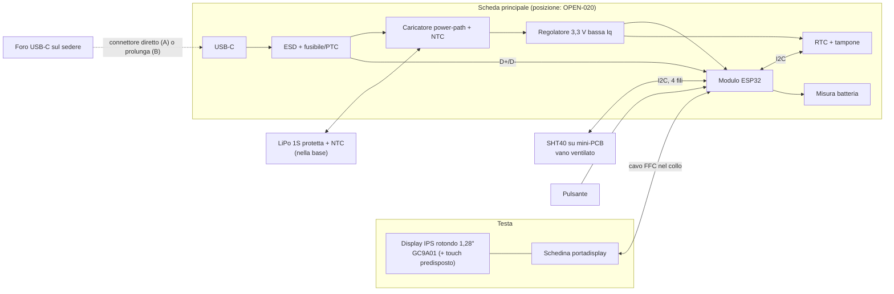

# 02 — Architettura hardware

**Versione:** 0.4 · **Stato:** architettura PCB custom candidata, non validata · **Data:** 2026-11-07

## 1. Strategia

La V1 usa un **PCB custom progettato in KiCad e prodotto/assemblato da JLCPCB** (`DEC-015`), con il minimo indispensabile per le funzioni richieste. La scheda integrata Waveshare ESP32-S3-Touch-AMOLED-1.75 (ex `CAND-001`) è stata scartata per costo e per i componenti superflui.

L'elettronica è divisa in **schede separate** (`DEC-021`):

1. **Scheda principale** rettangolare, **separata dal display**: MCU, carica, alimentazione, RTC, USB-C, connettori. Posizione nella statuetta da decidere con la bozza CAD (busto/base o testa, `OPEN-020`).
2. **Schedina portadisplay** rotonda nella testa: solo il connettore del pannello, i condensatori di disaccoppiamento e il connettore del cavo verso la scheda principale.
3. **Mini-PCB SHT40** nel vano ventilato.

Scheda principale e portadisplay sono collegate da un **cavo piatto FFC** (o cavetto JST-SH) che attraversa il collo (`CAND-020`). Tutte le schede si ordinano nello **stesso pannello JLC**.

Il PCB custom **non** è più economico per un solo esemplare (costi fissi di assemblaggio, spedizione, possibile seconda revisione): la scelta è motivata da controllo dei consumi, sicurezza della ricarica e integrazione nella statuetta.

Per ridurre il rischio di una revisione sbagliata, prima del disegno si valida l'architettura **su banco con moduli commerciali economici**, con cavi display della stessa lunghezza prevista (vedi [roadmap](09-roadmap.md), M1).

Non confondere la disponibilità di una funzione nel datasheet con il suo corretto funzionamento nel nostro montaggio.

## 2. Schema a blocchi

Il diagramma descrive funzioni logiche: non sostituisce lo schema elettrico KiCad.

## 3. Blocchi funzionali e candidati

Tutti i codici sono **CAND**: da verificare su datasheet, disponibilità e prezzo LCSC/JLCPCB (preferire parti "basic" per ridurre i costi fissi di assemblaggio).

| Blocco | Funzione | Requisiti | Candidati (CAND) |
|---|---|---|---|
| MCU | Logica, UI, gestione energia | Supporto ESP-IDF, USB nativa per flash/log/configuratore, light-sleep, SPI + I²C + ADC + PWM, GPIO di risveglio per pulsante e touch | Modulo **ESP32-C3-MINI-1** (consigliato) o ESP32-S3-MINI-1; modulo certificato con antenna/flash integrate |
| Display | Volto | Rotondo, IPS, **1,28"**, **240×240**, driver **GC9A01**, SPI 4 fili (`DEC-016`) | Pannello nudo con FPC, disponibile con e senza touch (`DEC-019`) |
| Portadisplay | Interfaccia pannello ↔ cavo | Connettore FPC del pannello, condensatori vicino al pannello, connettore del cavo; sagoma e fori per il fissaggio nella testa | Schedina rotonda a 2 strati, nessun componente attivo |
| Collegamento display | Testa ↔ scheda principale | Circa **12 conduttori**: 3,3 V, GND (più di uno, alternati ai segnali), SCLK, MOSI, CS, DC, RST, BL; touch: SDA, SCL, INT, RST. Lunghezza indicativa 5–15 cm | **FFC** passo 0,5 mm con connettori ZIF (consigliato) o cavetto JST-SH; SPI a **10–20 MHz** da validare in M1 (`CAND-020`) |
| Retroilluminazione | DIM/BRIGHT/NIGHT | PWM, spegnibile del tutto di notte | MOSFET/transistor + resistenza; valori dal datasheet del pannello |
| Interazione | Accendere/impostare | **Pulsante** fisico (`DEC-017`), posizione da definire | Pulsante su scheda o remoto via cavo; pull-up e antirimbalzo; GPIO con risveglio |
| Touch (predisposto) | Opzione futura (`DEC-019`) | Controller del pannello su I²C + **INT** (GPIO con risveglio) + **RST** portati nel cavo; componenti non montati se non serve | Controller tipico dei pannelli 1,28" (es. famiglia CST816), da confermare sul datasheet |
| USB | Ricarica, flash, configuratore (`DEC-020`) | USB-C 2.0, CC 5,1 kΩ, ESD, fusibile/PTC; D+/D- alla USB nativa dell'MCU secondo le design guideline Espressif | Ricettacolo USB-C sulla scheda principale; ESD tipo USBLC6-2 |
| Caricatore | Ricarica sicura | **Power-path** (`DEC-008`), ingresso **NTC cella**, corrente di carica prudente, 4,2 V | BQ24074 (TI) o equivalente (`CAND-013`) |
| Regolatore 3,3 V | Alimentare MCU, display, sensori | Bassa Iq; picchi MCU; comportamento a 3,0–3,4 V di cella | LDO bassa Iq o buck-boost (es. TPS63802) (`CAND-015`) |
| RTC | Ora anche con scarica completa | Bassissimo consumo, tampone, I²C | RV-3028-C7 o PCF85063A + tampone (`CAND-014`) |
| Misura batteria | Livelli batteria | Niente percentuali inventate | Partitore commutato su ADC o fuel gauge I²C (`CAND-016`) |
| Sensore T/RH | Misure ambiente | **SHT40** su mini-PCB senza LED, 4 fili | Mini-PCB nello stesso pannello JLC |
| Connettori | Batteria, SHT40, pulsante | Polarizzati, con ritenuta, polarità serigrafata | JST-PH 2,0 o JST-SH 1,0 |
| Debug | Bring-up | Punti di test VBUS, VBAT, 3,3 V, GND; BOOT/RESET | — |

## 4. Collegamento display su cavo

- Il SPI del GC9A01 su un cavo di qualche centimetro è affidabile se: frequenza moderata (10–20 MHz iniziali), **masse alternate** ai segnali veloci (soprattutto SCLK), eventuali resistenze serie di smorzamento vicino all'MCU, condensatori di disaccoppiamento **sul portadisplay**.
- A 20 MHz un'immagine completa 240×240 a 16 bit (circa 115 kB) richiede circa 50 ms: più che sufficiente per un orologio che aggiorna il minuto.
- La retroilluminazione è la corrente maggiore che passa nel cavo: dimensionare i conduttori di alimentazione (più pin in parallelo se necessario).
- Il cavo deve piegarsi nel collo senza tensione sui connettori; fissarlo con fermacavo.

## 5. Sensore temperatura/umidità

**Sensirion SHT40** è la scelta candidata. Specifica tipica: ±1,8 %RH; la temperatura ha accuratezza tipica dichiarata dal costruttore in condizioni specificate dal datasheet. Vedere [pagina prodotto](https://sensirion.com/products/catalog/SHT40).

- Montato su un **mini-PCB** prodotto insieme alle altre schede: niente LED, niente regolatore, pull-up I²C sulla scheda principale.
- Posizionamento **separato fisicamente** dalle sorgenti di calore (scheda principale, retroilluminazione, batteria), con feritoie verso l'aria ambiente.
- Cavo a 4 fili con connettore polarizzato e fermacavo.
- Indirizzo tipico `0x44`: verificare assenza di conflitti con RTC, touch e fuel gauge.
- Campionamento iniziale consigliato **30–60 s** (parametro firmware).

## 6. Scelte intenzionalmente escluse

Non servono per V1: audio, microSD, IMU, GPS, touch montato (solo predisposto, `DEC-019`), sensore CO₂, sensore luce, Wi-Fi/BLE (`DEC-012`), convertitore USB-seriale esterno, secondo caricabatterie in parallelo.

## 7. Interfacce e verifiche prima dell'ordine PCB

| Interfaccia | Uso previsto | Verifica obbligatoria |
|---|---|---|
| USB-C | Alimentazione, ricarica, flash, configuratore | Opzione A: connettore sul bordo della scheda allineato al foro sul sedere. Opzione B: enumerazione attraverso la prolunga provata su banco |
| Batteria | LiPo 1S protetta | **Polarità** del connettore contro la cella reale; NTC compatibile con il caricatore |
| Display su cavo | GC9A01 via SPI | Pinout FPC dal datasheet del pannello **acquistato**; prova su banco con cavo di lunghezza reale e frequenza scelta |
| I²C | RTC, SHT40, touch, eventuale fuel gauge | Indirizzi, pull-up unici, lunghezze cavo |
| Pulsante | Risveglio/illuminazione UI | Risveglio da light-sleep provato sulla dev board |
| Touch (predisposto) | Opzione futura | Pinout touch del pannello; GPIO INT/RST con risveglio (`OPEN-019`) |
| USB dati / configuratore | Impostazioni da PC | Porta seriale e comandi funzionanti anche dopo light-sleep |
| RTC | Unica fonte di tempo in V1 | Mantenimento con LiPo scollegata grazie al tampone |

## 8. Alternative e rischi

- **Prima revisione PCB con errori**: probabile. Mitigazione: prototipo M1, revisione schema con checklist, punti di test, 0 Ω/jumper per isolare i blocchi, revisione visiva del proprietario in KiCad.
- **Disturbi sul cavo display**: frequenza SPI ridotta, masse alternate, prova su banco con cavo reale.
- **Pannello senza datasheet affidabile**: acquistare solo pannelli con pinout FPC documentato.
- **Componenti non disponibili a JLC**: verificare LCSC prima del layout; alternative compatibili a pin.
- **Spazio nel busto insufficiente** per scheda + batteria: decidere la posizione con la bozza Blender (`OPEN-020`).
- **Piano B**: schede commerciali con ESP32 e display rotondo 1,28" integrato.

## 9. Gate di conferma hardware

Il PCB diventa `APPROVATO` solo dopo: revisione schema e layout (ERC/DRC puliti, checklist, revisione visiva del proprietario in KiCad), bring-up delle alimentazioni con limitazione di corrente, flash e configuratore via USB-C posteriore, display stabile sul cavo reale, pulsante, lettura SHT40 e RTC, prova carica/scarica con la cella scelta e cutoff NTC verificato, misura dell'assorbimento in DIM, BRIGHT, NIGHT e spento.
