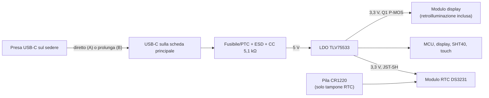

# 03 — Alimentazione

**Versione:** 0.7 · **Stato:** schema e PCB rev 0.2 (bozza), non validati · **Data:** 2026-11-07

> Il nome del file è rimasto `03-alimentazione-ricarica.md` per non rompere i collegamenti: dalla v0.5 la V1 **non ha batteria né ricarica** (`DEC-023`).

## 1. Requisiti confermati

- **CONF:** alimentazione **continua da USB 5 V**, nessuna batteria nella V1 (`DEC-023`). Senza cavo l'orologio è spento.
- **CONF:** presa **USB-C** nella **parte posteriore bassa** della statuetta (sul sedere) (`DEC-011`, `DEC-018`): connettore saldato sulla scheda principale se questa sta nel busto/base, prolunga se sta nella testa (`DEC-021`, `OPEN-020`).
- **CONF:** schermo attenuato normalmente, luminoso dopo il pulsante, spento di notte (`DEC-007`, `DEC-009`).
- **CONF:** l'ora resta salva a cavo scollegato grazie all'**RTC con tampone**: modulo esterno Adafruit DS3231 STEMMA QT con pila CR1220 (`DEC-024`).

Le decisioni sull'autonomia (`DEC-008`, `DEC-014`) e i requisiti di batteria sono superati per la V1; un'eventuale batteria verrà rivalutata in versioni successive.

## 2. Architettura

- **Regolatore 3,3 V** da 5 V: LDO **TI TLV75533PDBVR** (C404027, `DEC-037`), 500 mA, **stabile con condensatori ceramici ≥ 1 µF** (datasheet SBVS320D). C2 10 µF in ingresso, C3 10 µF + C4 100 nF in uscita, a 2,4–2,8 mm dai pin. Dissipazione indicativa: (5 − 3,3) V × corrente; con ~80 mA stimati circa 0,14 W, cioè +14…32 °C sul chip con RθJA tra 100,8 °C/W (rame della scheda di valutazione TI) e 231 °C/W (JEDEC): da misurare a scocca chiusa (`VT-PWR-002`). La sorgente da 500 mA soddisfa la richiesta Espressif per il modulo.
- **Protezione ingresso**: PTC 0805 hold 0,5 A (BSMD0805-050-12V), ESD USBLC6-2SC6 su D+/D- e VBUS, Rd 5,1 kΩ su CC1/CC2, resistenza 0 Ω per isolare il regolatore durante il bring-up.
- **Display e retroilluminazione**: il modulo GC9A01 a 7 pin (`DEC-034`) non ha un pin per la retroilluminazione, che resta accesa finché il modulo è alimentato. Il P-MOS **Q1 (AO3401A)**, comandato da IO20, alimenta il modulo dal 3,3 V e lo spegne del tutto di notte (`DEC-009`); R17 lo tiene spento durante reset e boot. Corrente della retroilluminazione da misurare sul modulo ricevuto (`OPEN-016`).
- **Tampone dell'RTC**: pila CR1220 sul modulo DS3231 (`DEC-024`), che commuta da solo sulla pila quando manca il 3,3 V; durata attesa di anni secondo Adafruit, da verificare (`OPEN-014`). Il modulo è alimentato dal 3,3 V tramite il connettore J4 (resistenza 0 Ω R21). La pila serve solo a conservare l'ora: non alimenta l'orologio (`DEC-023`).
- Nessun caricatore, nessuna misura batteria, nessun power-path.

## 3. USB-C

- **Opzione A (preferita)**: scheda principale nel busto/base con il ricettacolo USB-C saldato sul bordo, affacciato al foro sul sedere. La scheda va avvitata alla scocca perché assorbe gli sforzi di inserimento.
- **Opzione B**: scheda nella testa e **prolunga USB-C** maschio→femmina da pannello con linee dati USB 2.0.

Criteri di verifica:

1. Inserimento/rimozione del cavo con lo sforzo scaricato sulla scocca, non sulle saldature del connettore.
2. Funzionamento con alimentatori USB 5 V comuni e con la porta USB di un PC; nessuna dipendenza da USB-PD (resistenze CC 5,1 kΩ).
3. Enumerazione USB, flash firmware e configuratore funzionanti dalla presa posteriore.
4. Funzionamento continuo 24/7 senza surriscaldamenti di regolatore, connettori e cavi.
5. Stabilità della statuetta con il cavo sempre inserito (uscita guidata nella base).

## 4. Consumi e calore

L'autonomia non è più un vincolo, ma il consumo resta importante perché **ogni milliwatt diventa calore dentro la statuetta** e può falsare la misura del SHT40.

- Display spento di notte (modulo non alimentato); di giorno la luminosità della retroilluminazione è fissa: DIM e BRIGHT si distinguono solo per i colori della grafica (`DEC-034`).
- Aggiornamento dell'ora solo al cambio minuto; redraw parziali.
- Radio Wi-Fi/BLE mai attivata (`DEC-012`).
- Light-sleep **facoltativo**: da adottare solo se le misure mostrano che riduce in modo utile il riscaldamento interno (senza light-sleep la USB del configuratore resta sempre attiva).

### Profili di misura

- `P1 DIM`: funzionamento principale con ora e dati visibili, grafica attenuata (retroilluminazione fissa).
- `P2 BRIGHT`: grafica a piena luminosità dopo pressione del pulsante.
- `P3 NIGHT`: modulo display non alimentato (Q1 spento).
- `P5 OFF`: cavo scollegato, assorbimento dal tampone dell'RTC.

Misurare corrente in ingresso USB (media e picchi) e temperature interne a scocca chiusa.

## 5. Gestione di scollegamento e guasti

- Scollegare il cavo in qualunque momento non deve corrompere NVS: scritture di configurazione rare e atomiche; brown-out detector abilitato.
- Al ricollegamento: avvio pulito, ora dall'RTC; se il tampone è esaurito, `TIME_NOT_SET`.
- Qualsiasi anomalia termica o del connettore blocca la validazione e richiede indagine.

## 6. Gate di sicurezza prechiusura scocca

- [ ] Fusibile/PTC, ESD e resistenze CC verificati a schema e su banco.
- [ ] Assorbimento massimo e medio misurati.
- [ ] Temperature di regolatore, MCU e retroilluminazione misurate a scocca chiusa dopo almeno 24 h di funzionamento.
- [ ] Connettore USB-C, eventuale prolunga e cablaggi protetti da sollecitazioni.
- [ ] Tampone RTC verificato: ora mantenuta a cavo scollegato (pila CR1220 del modulo DS3231).
- [ ] Cicli ripetuti di scollegamento/ricollegamento senza errori.

## 7. Questioni aperte

Durata reale del tampone RTC (`OPEN-014`); dissipazione del TLV75533 a scocca chiusa; corrente del modulo display (`OPEN-016`); consumi reali in DIM/BRIGHT/NIGHT; posizione della scheda e quindi della USB-C (`OPEN-020`, `OPEN-028`). Vedi [decision log](10-decisioni-aperte.md).
