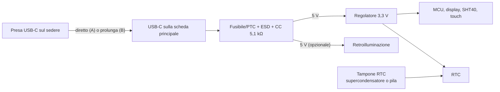

# 03 — Alimentazione

**Versione:** 0.5 · **Stato:** progettazione preliminare PCB custom · **Data:** 2026-11-07

> Il nome del file è rimasto `03-alimentazione-ricarica.md` per non rompere i collegamenti: dalla v0.5 la V1 **non ha batteria né ricarica** (`DEC-023`).

## 1. Requisiti confermati

- **CONF:** alimentazione **continua da USB 5 V**, nessuna batteria nella V1 (`DEC-023`). Senza cavo l'orologio è spento.
- **CONF:** presa **USB-C** nella **parte posteriore bassa** della statuetta (sul sedere) (`DEC-011`, `DEC-018`): connettore saldato sulla scheda principale se questa sta nel busto/base, prolunga se sta nella testa (`DEC-021`, `OPEN-020`).
- **CONF:** schermo attenuato normalmente, luminoso dopo il pulsante, spento di notte (`DEC-007`, `DEC-009`).
- **CONF:** l'ora resta salva a cavo scollegato grazie all'**RTC con tampone**.

Le decisioni sull'autonomia (`DEC-008`, `DEC-014`) e i requisiti di batteria sono superati per la V1; un'eventuale batteria verrà rivalutata in versioni successive.

## 2. Architettura

- **Regolatore 3,3 V** da 5 V: un LDO è sufficiente. Dissipazione indicativa: (5 − 3,3) V × corrente; con 100 mA circa 0,17 W, da verificare con le misure reali e la superficie di rame.
- **Retroilluminazione** alimentata da 3,3 V o da 5 V secondo il datasheet del pannello.
- **Tampone dell'RTC**: supercondensatore (ricaricato dal 3,3 V tramite resistenza/diodo o dal circuito interno dell'RTC, se previsto) o pila a bottone. Dimensionare per mantenere l'ora almeno per **alcuni giorni** a cavo scollegato (`OPEN-014`).
- Nessun caricatore, nessuna misura batteria, nessun power-path.

## 3. USB-C

- **Opzione A (preferita)**: scheda principale nel busto/base con il ricettacolo USB-C saldato sul bordo, affacciato al foro sul sedere. La scheda va avvitata alla scocca perché assorbe gli sforzi di inserimento.
- **Opzione B**: scheda nella testa e **prolunga USB-C** maschio→femmina da pannello con linee dati USB 2.0.

Criteri di verifica:

1. Inserimento/rimozione del cavo con lo sforzo scaricato sulla scocca, non sulle saldature del connettore.
2. Funzionamento con alimentatori USB 5 V comuni e con la porta USB di un PC; nessuna dipendenza da USB-PD (resistenze CC 5,1 kΩ).
3. Enumerazione USB, flash firmware e configuratore funzionanti dalla presa posteriore.
4. Funzionamento continuo 24/7 senza surriscaldamenti di regolatore, connettori e cavi.
5. Stabilità della statuetta con il cavo sempre inserito (uscita guidata nella base).

## 4. Consumi e calore

L'autonomia non è più un vincolo, ma il consumo resta importante perché **ogni milliwatt diventa calore dentro la statuetta** e può falsare la misura del SHT40.

- Retroilluminazione bassa in DIM e spenta di notte.
- Aggiornamento dell'ora solo al cambio minuto; redraw parziali.
- Radio Wi-Fi/BLE mai attivata (`DEC-012`).
- Light-sleep **facoltativo**: da adottare solo se le misure mostrano che riduce in modo utile il riscaldamento interno (senza light-sleep la USB del configuratore resta sempre attiva).

### Profili di misura

- `P1 DIM`: funzionamento principale con ora e dati visibili, retroilluminazione bassa.
- `P2 BRIGHT`: retroilluminazione alta dopo pressione del pulsante.
- `P3 NIGHT`: display e retroilluminazione spenti.
- `P5 OFF`: cavo scollegato, assorbimento dal tampone dell'RTC.

Misurare corrente in ingresso USB (media e picchi) e temperature interne a scocca chiusa.

## 5. Gestione di scollegamento e guasti

- Scollegare il cavo in qualunque momento non deve corrompere NVS: scritture di configurazione rare e atomiche; brown-out detector abilitato.
- Al ricollegamento: avvio pulito, ora dall'RTC; se il tampone è esaurito, `TIME_NOT_SET`.
- Qualsiasi anomalia termica o del connettore blocca la validazione e richiede indagine.

## 6. Gate di sicurezza prechiusura scocca

- [ ] Fusibile/PTC, ESD e resistenze CC verificati a schema e su banco.
- [ ] Assorbimento massimo e medio misurati.
- [ ] Temperature di regolatore, MCU e retroilluminazione misurate a scocca chiusa dopo almeno 24 h di funzionamento.
- [ ] Connettore USB-C, eventuale prolunga e cablaggi protetti da sollecitazioni.
- [ ] Tampone RTC verificato: ora mantenuta a cavo scollegato per la durata dichiarata.
- [ ] Cicli ripetuti di scollegamento/ricollegamento senza errori.

## 7. Questioni aperte

Tipo e capacità del tampone dell'RTC (`OPEN-014`); LDO scelto e sua dissipazione; alimentazione della retroilluminazione da 3,3 V o 5 V; consumi reali in DIM/BRIGHT/NIGHT; posizione della scheda e quindi della USB-C (`OPEN-020`). Vedi [decision log](10-decisioni-aperte.md).
