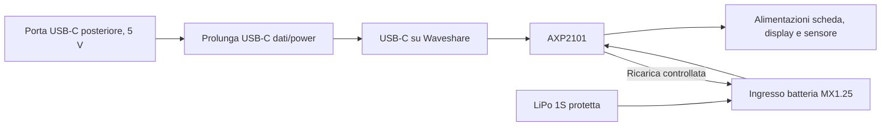

# 03 — Alimentazione, ricarica e budget energetico

**Versione:** 0.1 · **Stato:** progettazione preliminare / safety gate aperto · **Data:** 2026-11-07

## 1. Requisiti confermati e obiettivo

- **CONF:** PoliClock opera senza cavo, alimentato da batteria ricaricabile interna.
- **CONF:** connettore **USB-C sul retro della statuetta**, accessibile senza smontarla.
- **CONF:** interfaccia sempre visibile in modalità **attenuata**, con breve incremento della luminosità dopo un'interazione.
- **TGT:** valutare un'autonomia di **almeno 48 ore**; non confermata finché non viene misurata sul dispositivo completo.

## 2. Architettura candidata

I collegamenti riportati rappresentano la funzione desiderata; la topologia **esatta** (power-path e alimentazione simultanea) va verificata sullo schematico Waveshare della revisione acquistata e confermata in prova.

Non installare un caricabatteria TP4056 aggiuntivo in serie/parallelo all'AXP2101: si rischia di creare due circuiti di carica concorrenti.

## 3. Batteria candidata

- Cella singola **LiPo 1S**, tensione nominale tipica **3,7 V**.
- Capacità iniziale da esplorare: **2.500–3.000 mAh**, non definitiva.
- Cella protetta e di provenienza verificabile, con datasheet/identificazione e limiti di carica/scarica documentati.
- Connessione a 2 poli: verificare **passo, forma del connettore e soprattutto polarità**, anche se dichiarato compatibile MX1.25.
- La cella non deve essere compressa da viti, supporti o dalle superfici stampate; nessun spigolo vivo nella sua sede.
- Dimensionamento termico e fissaggio meccanico devono essere approvati prima di chiudere la statuetta.

L'eventuale sensore termico di batteria (NTC) e i requisiti di protezione devono essere verificati sul circuito reale e sul datasheet della cella. Non assumere che un connettore a 2 fili fornisca automaticamente misura termica o tutte le protezioni necessarie.

## 4. USB-C e ricarica in uso

Usare una **prolunga USB-C maschio→femmina da pannello**, corta e con linee dati USB 2.0, fissata meccanicamente nella parte posteriore. Evitare adattatori solo power che impedirebbero il flashing USB.

Criteri di verifica:

1. Inserimento/rimozione del cavo senza trasferire carico meccanico alla USB della scheda.
2. Ricarica da alimentatore USB 5 V affidabile; nessuna dipendenza da USB-PD ad alta tensione.
3. Comunicazione dati USB disponibile attraverso la prolunga per il flash firmware.
4. Funzionamento del sistema con batteria collegata e USB presente, **solo dopo verifica elettrica/termica**.
5. Nessun surriscaldamento anomalo di cella, PMU, connettori e cablaggi durante il ciclo di carica e display acceso.

## 5. Calcolo preliminare autonomia

Per definire un ordine di grandezza, con capacità nominale **3.000 mAh** e una quota utilizzabile *ipotetica* dell'**80%** (margine per perdite, cutoff, invecchiamento e variabilità), si ottiene:

`C_utilizzabile = 3.000 × 0,80 = 2.400 mAh`

`Autonomia stimata [h] = C_utilizzabile [mAh] / I_media_batteria [mA]`

| I media misurata **alla batteria** | Autonomia teorica illustrativa |
|---:|---:|
| 30 mA | 80 h |
| 40 mA | 60 h |
| 50 mA | 48 h |
| 60 mA | 40 h |
| 100 mA | 24 h |

**Nessuno di questi valori è una misura del dispositivo.** Per arrivare a 48 h nell'ipotesi sopra, la corrente media **deve essere ≤ 50 mA**. Non si può usare il solo consumo in deep-sleep dell'ESP32: in modalità normale il display rimane acceso, con contribuzione dell'AMOLED, del PMU e dell'elettronica della scheda.

### Profili di misura richiesti

- `P0 USB`: dispositivo acceso, alimentatore USB collegato, batteria in carica.
- `P1 DIM`: funzionamento principale con ora e dati visibili a bassa luminosità, Wi-Fi inattivo.
- `P2 BRIGHT`: aumento luminosità dopo touch per durata transitoria configurata.
- `P3 RADIO`: sincronizzazione NTP con Wi-Fi temporaneamente attivo (se adottata).
- `P4 LOW_BATT`: avviso batteria bassa, display ridotto/spegnimento gestito.
- `P5 OFF`: assorbimento residuo a sistema spento; comportamento RTC.

Misurare corrente batteria con strumento idoneo, distinguere media e picchi, e annotare tensione batteria, luminosità, firmware, configurazione e temperature.

## 6. Politica energetica software proposta

- Schermata dim **normalmente sempre visibile**.
- Frame rate ridotto e aggiornamento dell'ora solo quando cambia il minuto; evitare redraw completo non necessario.
- Campionamento SHT40 ogni **30–60 s**, da tarare.
- Radio Wi-Fi **spenta nella normale visualizzazione**; sincronizzazione NTP opzionale a intervalli lunghi.
- Interazione touch → `BRIGHT` per **circa 20 s** (default proposto) → ritorno a `DIM`.
- Evitare polling continuo di touch/IMU se la modalità di interrupt risulta verificata e più efficiente.
- Evitare contenuti statici luminosi a lungo (mitigazione burn-in AMOLED).

I valori di luminosità in percentuale sono **parametri UI**, non valori di potenza o luminanza fisica garantiti; saranno calibrati a vista e a banco.

## 7. Gestione batteria e guasti

- Leggere lo stato di alimentazione, tensione e carica dalla PMU solo tramite API e registri confermati per AXP2101.
- **Non rappresentare una percentuale 'precisa'** calcolata banalmente dalla tensione sotto carico; preferire indicatore a livelli o modello calibrato.
- Valutare soglia di avviso, soglia critica e isteresi dopo prove su batteria reale; **nessuna soglia numerica ancora fissata**.
- In caso di tensione critica: segnalazione breve, salvataggio impostazioni se necessario, spegnimento controllato; affidare la protezione estrema all'hardware idoneo.
- A USB scollegata e batteria scarica: evitare boot-loop.
- Qualsiasi anomalia termica o del connettore blocca la validazione e richiede indagine.

## 8. Gate di sicurezza prechiusura scocca

- [ ] Cella e scheda hanno documentazione tecnica e compatibilità confermata.
- [ ] Corrente di ricarica effettiva compatibile con la cella.
- [ ] Polarità verificata elettricamente prima dell'inserimento.
- [ ] Connettore, cablaggio e fissaggio USB-C protetti da sollecitazioni.
- [ ] Prove carica a USB presente e funzionamento simultaneo completate senza anomalie.
- [ ] Misure termiche documentate nelle condizioni peggiori ragionevolmente previste.
- [ ] Batteria fisicamente isolata da spigoli, viti, parti calde e pressioni della scocca.
- [ ] Stato batteria bassa, cutoff e riavvio con USB verificati.

## 9. Questioni aperte

Capacità/dimensioni cella; parametro di carica AXP2101; monitoraggio temperatura cella; disponibilità reale di power-path del modulo; consumi AMOLED dim; trigger touch a basso consumo; connettore MX1.25 e polarità; forma/posizione USB-C; accuratezza stato carica. Vedi [decision log](10-decisioni-aperte.md).
