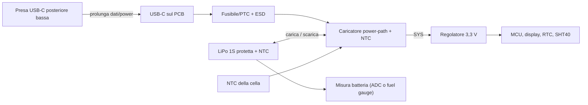

# 03 — Alimentazione, ricarica e budget energetico

**Versione:** 0.3 · **Stato:** progettazione preliminare PCB custom / safety gate aperto · **Data:** 2026-11-07

## 1. Requisiti confermati e obiettivo

- **CONF:** PoliClock opera senza cavo, alimentato da batteria ricaricabile interna.
- **CONF:** presa **USB-C** nella **parte posteriore bassa** della statuetta (sul sedere), collegata al PCB con una **prolunga** (`DEC-011`, `DEC-018`).
- **CONF:** interfaccia sempre visibile in modalità **attenuata**, con breve incremento della luminosità dopo la pressione del pulsante.
- **CONF:** di notte il display è spento (`DEC-009`, `DEC-013`).
- **CONF:** ricarica circa ogni 2 giorni accettabile; uso frequente con USB collegata accettabile (`DEC-008`).
- **CONF:** elettronica su **PCB custom** (`DEC-015`): caricatore, regolatore e protezioni sono progettati da noi e vanno verificati con più cura.
- **TGT:** autonomia di **almeno 48 ore** al profilo `DEC-014`; non confermata finché non viene misurata sul dispositivo completo.

## 2. Architettura candidata

- **Power-path obbligatorio**: con la USB collegata il sistema è alimentato dall'ingresso e la cella viene caricata in parallelo; senza USB il sistema passa alla cella senza interruzioni.
- **Un solo caricatore**: niente moduli di carica aggiuntivi in parallelo.
- La topologia esatta dipende dal caricatore scelto: definirla sul suo datasheet e verificarla su banco (M1) prima del layout.

## 3. Batteria candidata

- Cella singola **LiPo 1S**, tensione nominale tipica **3,7 V**, carica a 4,2 V.
- Capacità iniziale: **2.500–3.000 mAh**, da rivedere dopo le misure di consumo. Con l'IPS spento di notte potrebbe bastare meno: decidere su dati.
- **Protetta** (circuito di protezione integrato) e con **NTC** se disponibile, di provenienza verificabile, con datasheet e limiti di carica/scarica.
- Connettore polarizzato scelto **insieme** al PCB: la polarità sul PCB va disegnata sulla polarità reale della cella acquistata, non su una convenzione presunta.
- Collocata nella **base**: cavi verso la testa attraverso il corpo, con fermacavi e protezione dallo sfregamento.
- La cella non deve essere compressa da viti, supporti o superfici stampate; nessun spigolo vivo nella sua sede.

Con il PCB custom la temperatura della cella è sorvegliata dal caricatore tramite l'NTC (`OPEN-013` risolvibile in progetto). Se la cella non ha NTC, prevedere un termistore fissato alla cella o una corrente di carica molto prudente, e documentare la scelta.

## 4. USB-C, prolunga e ricarica in uso

Una **prolunga USB-C maschio→femmina da pannello**, con linee dati USB 2.0, collega la presa posteriore bassa al connettore USB-C del PCB nella testa. Lunghezza indicativa 15–25 cm, da misurare sul CAD.

Criteri di verifica:

1. Inserimento/rimozione del cavo senza trasferire carico meccanico al connettore del PCB.
2. Ricarica da alimentatore USB 5 V affidabile; nessuna dipendenza da USB-PD (resistenze CC 5,1 kΩ sul PCB).
3. Enumerazione USB e flash firmware funzionanti **attraverso la prolunga**.
4. Funzionamento con USB collegata anche per giorni (`DEC-008`), **solo dopo verifica elettrica/termica**.
5. Nessun surriscaldamento anomalo di cella, caricatore, regolatore, connettori e cablaggi.
6. Caduta di tensione sulla prolunga compatibile con la corrente di carica scelta.

## 5. Calcolo preliminare autonomia

Con capacità nominale **3.000 mAh** e una quota utilizzabile *ipotetica* dell'**80%**:

`C_utilizzabile = 3.000 × 0,80 = 2.400 mAh`

`Autonomia stimata [h] = C_utilizzabile [mAh] / I_media_batteria [mA]`

| I media misurata **alla batteria** | Autonomia teorica illustrativa |
|---:|---:|
| 30 mA | 80 h |
| 40 mA | 60 h |
| 50 mA | 48 h |
| 60 mA | 40 h |
| 100 mA | 24 h |

**Nessuno di questi valori è una misura del dispositivo.** Per 48 h la corrente media **deve essere ≤ 50 mA**.

Con il profilo `DEC-014` la media è circa `(16 × I_giorno + 8 × I_notte) / 24`. Esempio **illustrativo**: con `I_notte` ≤ 10 mA, `I_giorno` può arrivare a circa 70 mA. Con display IPS:

- di giorno consumano **retroilluminazione** (anche in DIM), pannello e MCU; il GC9A01 conserva l'immagine nella propria memoria, quindi l'MCU può sospendersi (light-sleep) tra un aggiornamento e l'altro;
- di notte retroilluminazione spenta e pannello in sleep: il consumo dovrebbe scendere molto, da misurare;
- conta anche la corrente di riposo di regolatore, caricatore e partitore di misura: sceglierli a bassa Iq.

### Profili di misura richiesti

- `P0 USB`: dispositivo acceso, alimentatore USB collegato, batteria in carica.
- `P1 DIM`: funzionamento principale con ora e dati visibili, retroilluminazione bassa, radio spenta.
- `P2 BRIGHT`: retroilluminazione alta dopo pressione del pulsante.
- `P3 NIGHT`: display e retroilluminazione spenti, RTC e pulsante attivi.
- `P4 LOW_BATT`: avviso batteria bassa, display ridotto/spegnimento gestito.
- `P5 OFF`: assorbimento residuo a sistema spento.

Misurare corrente batteria con strumento idoneo, distinguere media e picchi, e annotare tensione batteria, luminosità, firmware, configurazione e temperature.

## 6. Politica energetica software proposta

- Schermata DIM **normalmente sempre visibile** di giorno.
- Aggiornamento dell'ora solo al cambio minuto; redraw parziali.
- Campionamento SHT40 ogni **30–60 s**, da tarare.
- Radio Wi-Fi/BLE **mai attivata** in V1 (`DEC-012`).
- Pulsante → `BRIGHT` per **circa 20 s** → ritorno a `DIM`.
- Fascia notte → `NIGHT`: retroilluminazione spenta, pannello in sleep, MCU in sospensione con risveglio da timer e pulsante.

I valori di luminosità in percentuale sono **parametri PWM**, non valori di potenza o luminanza garantiti; saranno calibrati a vista e a banco.

## 7. Gestione batteria e guasti

- Stato di carica dai pin di stato del caricatore e dalla misura batteria scelta; **niente percentuali precise** calcolate dalla sola tensione sotto carico: indicatore a livelli o modello calibrato.
- Soglie di avviso, critica e isteresi definite dopo prove su batteria reale; **nessuna soglia numerica ancora fissata**.
- In tensione critica: segnalazione breve, salvataggio impostazioni, spegnimento controllato; la protezione estrema resta all'hardware (protezione cella e cutoff del caricatore).
- L'RTC con alimentazione tampone mantiene l'ora anche a cella scarica (`OPEN-014`); se il tampone è esaurito, al riavvio mostrare `TIME_NOT_SET`.
- A USB scollegata e batteria scarica: evitare boot-loop.
- Qualsiasi anomalia termica o del connettore blocca la validazione e richiede indagine.

## 8. Gate di sicurezza prechiusura scocca

- [ ] Schema del caricatore rivisto sul datasheet: corrente di carica, tensione finale, NTC, power-path.
- [ ] Corrente di carica effettiva misurata e compatibile con la cella.
- [ ] Cutoff per temperatura (NTC) provato su banco.
- [ ] Polarità del connettore batteria verificata elettricamente prima dell'inserimento.
- [ ] Prolunga, connettori e cablaggi protetti da sollecitazioni.
- [ ] Prove di carica con USB collegata e funzionamento simultaneo completate senza anomalie.
- [ ] Misure termiche documentate nelle condizioni peggiori ragionevolmente previste.
- [ ] Batteria fisicamente isolata da spigoli, viti, parti calde e pressioni della scocca.
- [ ] Stato batteria bassa, cutoff e riavvio con USB verificati.

## 9. Questioni aperte

Capacità e dimensioni della cella (condizionano base e gambe: sceglierla prima del CAD); cella con o senza NTC; caricatore e corrente di carica; regolatore (LDO o buck-boost); tipo di misura batteria; consumi reali IPS in DIM e NIGHT; lunghezza e qualità della prolunga. Vedi [decision log](10-decisioni-aperte.md).
