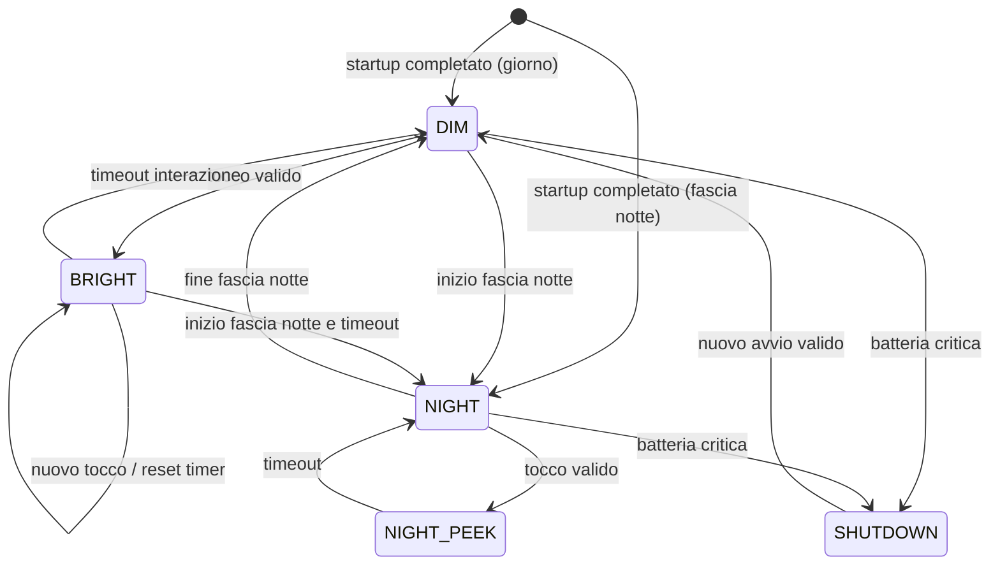

# 04 — Specifiche firmware

**Versione:** 0.1 · **Stato:** architettura proposta, codice non ancora implementato · **Data:** 2026-11-07

## 1. Tecnologia

Proposta: **ESP-IDF** per ESP32-S3, con versione SDK **pinnata dopo il bring-up** e dipendenze deterministiche. In sviluppo si possono riutilizzare BSP/esempi Waveshare; evitare dipendenze non documentate o copiate senza licenza.

Il firmware V1 ha una funzione: mantenere il quadrante aggiornato e leggibile, minimizzando il consumo senza compromettere l'orologio. Wi-Fi/NTP (`DEC-012`), Bluetooth, servizi cloud, domotica, audio, GPS, SD e OTA non sono requisiti V1: la radio non viene inizializzata.

## 2. Architettura a componenti

```text
firmware/                      # struttura futura, non ancora generata
├── main/
│   └── app_main.c             # inizializzazione e supervisione
├── components/
│   ├── board_support/         # BSP Waveshare, periferiche e pin reali
│   ├── time_service/          # RTC, UTC, timezone, impostazione offline
│   ├── climate_service/       # SHT40, validità dati e filtri
│   ├── power_service/         # AXP2101, USB, batteria, policy
│   ├── display_service/       # driver, backlight equivalente, refresh
│   ├── ui/                    # layout, widget, schermate
│   ├── input_service/         # touch ed eventi
│   ├── settings_service/      # NVS con schema/versione
│   └── diagnostics/           # logging e test di integrazione
└── test/                      # test unitari e banchi
```

**Separare il board support dalla logica prodotto**: il modulo Waveshare è candidato, e un eventuale cambio di scheda non deve imporre una riscrittura della UI o degli algoritmi di tempo/clima.

## 3. Contratti dati proposti

| Dato | Tipo logico | Origine | Regola |
|---|---|---|---|
| `time_utc` | timestamp UTC | RTC / impostazione manuale | Fonte unica per logica di tempo |
| `time_valid` | boolean | time_service | Falso se RTC mai impostato o perso dopo scarica |
| `local_time` | ora locale derivata | TZ Europe/Rome | DST applicata dalla timezone, non modificando arbitrariamente RTC |
| `temp_c` | float/decimo °C | SHT40 | Marcato invalido se misura/CRC errore |
| `rh_pct` | float/%RH | SHT40 | Valido nell'intervallo fisico e dentro freschezza ammessa |
| `climate_timestamp` | monotonic timestamp | climate_service | Indica ultima misura valida |
| `usb_present` | boolean | PMU | Stato aggiornato su evento/poll calibrato |
| `battery_state` | enum | PMU + logica | Normal / Low / Critical / Charging / Unknown |
| `display_mode` | enum | power/UI FSM | DIM / BRIGHT / NIGHT / NIGHT_PEEK / SHUTDOWN |
| `ui_flags` | set | servizi | CHARGING, LOW_BATT, TIME_NOT_SET, SENSOR_ERROR (indicatori sovrapposti, indipendenti dalla luminosità) |

Evitare accesso diretto ai registri della PMU dalla UI. La UI deve ricevere un modello immutabile coerente e un evento di aggiornamento.

## 4. Macchina a stati del display

La **luminosità** (`display_mode`) e gli **indicatori** (`ui_flags`) sono modelli separati: un indicatore come `LOW_BATT` o `CHARGING` compare in qualunque modo visibile senza cambiare stato FSM. Gli stati visuali del documento [UI](05-interfaccia-utente.md) corrispondono a questa combinazione.



- `DIM`: pagina principale in nero/blu scuro, luminosità bassa; **display acceso**.
- `BRIGHT`: stessa pagina con maggior luminosità per tempo configurabile (default sperimentale circa 20 s).
- `NIGHT`: display spento nella fascia notte (`PR-FUN-013`, default proposto 23:00–07:00); ESP32 sospeso con risveglio da timer/RTC e touch.
- `NIGHT_PEEK`: quadrante attenuato mostrato dopo un tocco notturno per il timeout, poi ritorno a `NIGHT` (`CAND-009`).
- `SHUTDOWN`: avviso breve e spegnimento controllato per batteria critica o comando power, lasciando alimentato l'RTC se l'hardware lo consente.

Lo stato `DIM` **non equivale** a deep sleep permanente: il display è attivo. Eventuali light-sleep/event wakeup dipendono da driver e interrupt verificati (touch `TP_INT` su GPIO11 secondo schematico).

## 5. Inizializzazione raccomandata

1. Inizializzazione minima logging, watchdog e NVS.
2. Board-support, bus I²C e PMU; conferma di tensioni e alimentazioni.
3. RTC, validazione data/ora e preferenze utente.
4. Display e touch; presentazione schermata di boot breve, senza attendere rete.
5. Sensore SHT40 e primo campionamento valido.
6. Disattivazione periferiche non usate (codec, amplificatore, microfoni, microSD, IMU).
7. Avvio servizi UI/tempo/alimentazione; ingresso in `DIM` o `NIGHT` secondo l'ora.

Errore su modulo non essenziale (es. sensore) non deve impedire il quadrante. Errore su RTC, batteria o display deve produrre stato diagnostico esplicito in log.

## 6. Tempo e RTC

- Riferimento interno in **UTC**.
- Presentazione configurata per **Europe/Rome**, con ora legale gestita correttamente; formato `HH:MM` 24h.
- Dopo cold boot, rilevare RTC mai inizializzato o dato palesemente invalido (incluso flag di perdita oscillatore del PCF85063, da verificare sul datasheet); **non mostrare un'ora inventata come corretta**.
- Unico percorso di impostazione in V1 (`DEC-012`, nessun NTP): menu touch o comando USB seriale di provisioning; almeno uno deve essere disponibile nella V1.
- Fascia notte (`PR-FUN-013`) salvata in NVS e modificabile con lo stesso percorso.
- Precisione di lungo periodo affidata al solo RTC: misurare la deriva in giorni/settimane e documentare se serve una correzione periodica (eventuale offset del PCF85063).
- Aggiornare la cifra dei minuti al cambio minuto; rilevare cambi di data, DST e riavvio.
- Validare comportamento RTC con USB staccata e batteria presente; con batteria rimossa o scarica segnalare `TIME_NOT_SET`.

## 7. Misurazioni ambientali

- Lettura I²C SHT40 con timeout, verifica CRC prevista dal protocollo e retry limitati.
- Campionamento iniziale **ogni 60 s**, configurabile da 30 a 60 s dopo misura dei consumi.
- Coerenza valori e filtraggio leggero opzionale per non far oscillare la UI; non mascherare variazioni reali.
- Dati invalidi o vecchi oltre due periodi di acquisizione: mostrare `--` con indicazione di sensore non disponibile.
- Non usare temperatura MCU come sostituto di temperatura ambiente.
- Segnalare in diagnostica la frequenza errori I²C e l'età dell'ultima misura valida.

## 8. Power manager

- Centralizzare la lettura PMU e i comandi display/power in un solo servizio.
- Esportare **eventi** su presenza USB, battery low/critical, timer bright, inizio/fine notte, campionamento.
- Ridurre i wakeup non necessari: niente busy loop, timer periodici coerenti con le necessità della UI.
- Tracciare il profilo di consumo nello stesso firmware, distinguendo build di test e release.
- Monitor batteria a livelli finché una percentuale attendibile non sia stata calibrata.

## 9. Affidabilità, sicurezza e qualità

- Stato osservabile con log seriali; severità distinta INFO/WARN/ERROR e messaggi non eccessivi.
- Watchdog configurato per task potenzialmente bloccanti; timeout I²C/rete; niente blocchi infiniti su init non critica.
- Configurazioni NVS versionate con default sicuri; test di first-boot/reset preferenze.
- Niente segreti nei log; il provisioning USB accetta solo comandi documentati (ora, data, fascia notte).
- Separare business logic dai driver: test unitari host per parsing/formatting tempo, DST, fascia notte (anche a cavallo della mezzanotte), scadenza sensore, FSM display e low-battery.
- Pixel shift periodico obbligatorio (`PR-UI-005`).
- Tenere uno strato di diagnostica minimale nel firmware release per indagini sul dispositivo assemblato.

## 10. Gate di completamento firmware

Tutti i test funzionali `VT-FUN-*`, `VT-FW-*` e `VT-PWR-*` previsti devono essere riproducibili; nessuna metrica di autonomia o consumo è accettata da log stimati senza misura strumentale. I requisiti di firmware devono sopravvivere a reset, USB plug/unplug, sensore scollegato, basso livello batteria, scarica completa, passaggio giorno/notte e ora legale.
