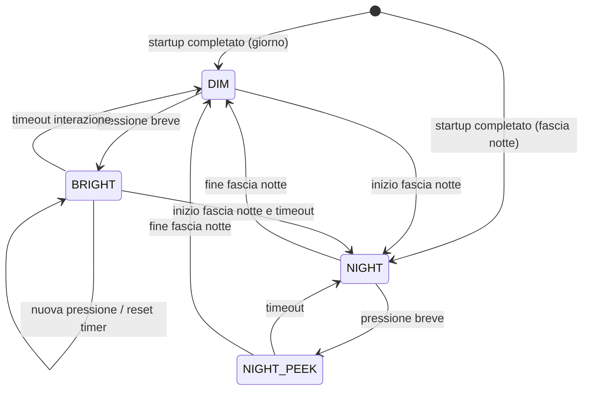

# 04 — Specifiche firmware

**Versione:** 0.7 · **Stato:** architettura proposta, codice non ancora implementato · **Data:** 2026-11-08

## 1. Tecnologia

Proposta: **ESP-IDF** per il modulo ESP32 del PCB custom (ESP32-C3 o S3, `CAND-012`), con versione SDK **pinnata dopo il bring-up** e dipendenze deterministiche. Il display GC9A01 può usare il driver `esp_lcd` della Component Registry di Espressif (verificare licenza e versione); evitare dipendenze non documentate o copiate senza licenza.

Il firmware nasce sul prototipo da banco (M1) e passa al PCB cambiando solo il board-support.

Il firmware V1 ha una funzione: mantenere il quadrante aggiornato e leggibile, minimizzando il consumo senza compromettere l'orologio. Wi-Fi/NTP (`DEC-012`), Bluetooth, servizi cloud, domotica, audio, GPS, SD e OTA non sono requisiti V1: la radio non viene inizializzata.

## 2. Architettura a componenti

```text
firmware/                      # struttura futura, non ancora generata
├── main/
│   └── app_main.c             # inizializzazione e supervisione
├── components/
│   ├── board_support/         # pin e periferiche: prototipo da banco e PCB custom
│   ├── time_service/          # RTC esterno, UTC, timezone, impostazione offline
│   ├── climate_service/       # SHT40, validità dati e filtri
│   ├── power_service/         # presenza USB, brown-out, alimentazione del modulo display (Q1), policy
│   ├── display_service/       # GC9A01, palette DIM/BRIGHT, accensione/spegnimento del modulo, refresh
│   ├── ui/                    # layout, widget, schermate
│   ├── input_service/         # pulsante -> eventi astratti (touch escluso, DEC-034)
│   ├── settings_service/      # NVS con schema/versione
│   ├── config_protocol/       # comandi del configuratore sulla seriale USB
│   └── diagnostics/           # logging e test di integrazione
└── test/                      # test unitari e banchi
```

**Separare il board support dalla logica prodotto**: prototipo da banco, revisioni del PCB ed eventuale piano B (scheda pronta) non devono imporre una riscrittura della UI o degli algoritmi di tempo/clima.

## 3. Contratti dati proposti

| Dato | Tipo logico | Origine | Regola |
|---|---|---|---|
| `time_utc` | timestamp UTC | RTC / impostazione manuale | Fonte unica per logica di tempo |
| `time_valid` | boolean | time_service | Falso se RTC mai impostato o perso a tampone esaurito |
| `local_time` | ora locale derivata | TZ Europe/Rome | DST applicata dalla timezone, non modificando arbitrariamente RTC |
| `temp_c` | float/decimo °C | SHT40 | Marcato invalido se misura/CRC errore |
| `rh_pct` | float/%RH | SHT40 | Valido nell'intervallo fisico e dentro freschezza ammessa |
| `climate_timestamp` | monotonic timestamp | climate_service | Indica ultima misura valida |
| `display_mode` | enum | power/UI FSM | DIM / BRIGHT / NIGHT / NIGHT_PEEK |
| `ui_flags` | set | servizi | TIME_NOT_SET, SENSOR_ERROR (indicatori sovrapposti, indipendenti dalla luminosità) |

Evitare accesso diretto all'hardware di alimentazione dalla UI. La UI deve ricevere un modello immutabile coerente e un evento di aggiornamento.

## 4. Macchina a stati del display

La **luminosità** (`display_mode`) e gli **indicatori** (`ui_flags`) sono modelli separati: un indicatore come `TIME_NOT_SET` o `SENSOR_ERROR` compare in qualunque modo visibile senza cambiare stato FSM. Gli stati visuali del documento [UI](05-interfaccia-utente.md) corrispondono a questa combinazione.



La retroilluminazione del modulo display a 7 pin **non è regolabile**: è sempre accesa quando il modulo è alimentato (`DEC-034`). La luminosità percepita si ottiene **solo con i colori della grafica**; il display si spegne togliendo alimentazione al modulo con il P-MOS Q1 (segnale `DISP_EN_N` su IO20: basso = acceso; R17 lo tiene spento al boot). Non esiste un PWM della retroilluminazione.

- `DIM`: pagina principale con **palette attenuata** (fondo nero, cifre in toni scuri/bassa luminanza); **modulo alimentato**.
- `BRIGHT`: stessa pagina con **palette piena** (colori chiari ad alto contrasto) per un tempo configurabile (default sperimentale circa 20 s).
- `NIGHT`: **modulo display spento** con Q1 nella fascia notte (`PR-FUN-013`, default 23:00–07:00, `DEC-013`, `DEC-009`). Il solo comando di sleep del controller non basta, perché la retroilluminazione resterebbe accesa. L'ESP32 resta attivo (light-sleep solo se utile, `OPEN-009`).
- `NIGHT_PEEK`: modulo riacceso, reinizializzato e quadrante con palette DIM mostrato dopo una pressione notturna per il timeout, poi ritorno a `NIGHT` (`CAND-009`). Se la fascia notte termina durante `NIGHT_PEEK`, si passa direttamente a `DIM` senza spegnere il modulo.

**Sequenze del modulo display (contratto per `display_service` / `power_service`):**

1. *Spegnimento* (`→ NIGHT`): fermare le scritture SPI; portare a livello **basso** LCD_SCLK, LCD_MOSI, LCD_DC, LCD_CS e LCD_RST; poi `DISP_EN_N` alto (Q1 aperto). Ordine pensato per non alimentare il modulo attraverso i pin di segnale (alimentazione parassita).
2. *Accensione* (`→ NIGHT_PEEK` o `→ DIM`): `DISP_EN_N` basso; attesa della stabilizzazione di 3V3_DISP (valore da misurare in M1, `VT-PCB-002`); impulso di reset su LCD_RST; inizializzazione completa del GC9A01; disegno del quadrante; solo allora la pagina è visibile.
3. Durante reset, boot e download dalla ROM il firmware non controlla i pin: R17 tiene il modulo spento, ma i livelli dei segnali in quella fase (per esempio il pull-up di reset dei pin JTAG) vanno misurati per escludere un'alimentazione parassita (rilievo della revisione del 2026-11-08, `VT-PWR-003`).
- Nessuno stato di spegnimento controllato: la V1 non ha batteria (`DEC-023`). Allo scollegamento del cavo il sistema si spegne; l'RTC resta alimentato dal tampone.

La **pressione lunga** apre il menu di impostazione (ora, data, fascia notte), vedi [UI](05-interfaccia-utente.md) e `OPEN-015`.

Con alimentazione continua il light-sleep **non è necessario**: il firmware può restare attivo, con aggiornamenti al cambio minuto e la USB del configuratore sempre disponibile. Il light-sleep si valuterà solo se le misure termiche mostrano un beneficio utile sulla misura del SHT40 (`OPEN-009`).

## 5. Inizializzazione raccomandata

1. Inizializzazione minima logging, watchdog e NVS.
2. Board-support, bus I²C, brown-out detector.
3. RTC, validazione data/ora e preferenze utente.
4. Accensione del modulo display (sequenza §4), inizializzazione del GC9A01 e del pulsante; presentazione schermata di boot breve. Se l'avvio cade nella fascia notte, il modulo resta spento.
5. Sensore SHT40 e primo campionamento valido.
6. Avvio servizi UI/tempo/alimentazione; ingresso in `DIM` o `NIGHT` secondo l'ora.

Errore su modulo non essenziale (es. sensore) non deve impedire il quadrante. Errore su RTC o display deve produrre stato diagnostico esplicito in log.

## 6. Tempo e RTC

- Riferimento interno in **UTC**.
- Presentazione configurata per **Europe/Rome**, con ora legale gestita correttamente; formato `HH:MM` 24h.
- Dopo cold boot, rilevare RTC mai inizializzato o dato palesemente invalido (flag di perdita alimentazione/oscillatore dell'RTC scelto, da verificare sul datasheet); **non mostrare un'ora inventata come corretta**.
- Impostazione in V1 senza rete (`DEC-012`): **configuratore da PC via USB** come metodo principale (§6.1, `DEC-020`), menu con il pulsante come riserva.
- Fascia notte (`PR-FUN-013`) salvata in NVS e modificabile con lo stesso percorso.
- Precisione di lungo periodo affidata al solo RTC: misurare la deriva in giorni/settimane e documentare se serve una correzione (registro di offset/aging dell'RTC scelto).
- Aggiornare la cifra dei minuti al cambio minuto; rilevare cambi di data, DST e riavvio.
- Validare il mantenimento dell'ora a cavo scollegato grazie al tampone; a tampone esaurito segnalare `TIME_NOT_SET`.

### 6.1 Protocollo del configuratore (proposta, `CAND-017`)

- Trasporto: porta seriale della USB nativa (USB Serial/JTAG), nessun driver aggiuntivo sul PC.
- Formato: comandi testuali a righe, risposte `OK ...` / `ERR <codice> <messaggio>`; utilizzabile anche da un terminale seriale.
- Il configuratore invia l'ora del PC in **UTC** (epoch); il firmware applica Europe/Rome e l'ora legale.
- Comandi iniziali proposti (nomi definitivi in M1):

| Comando | Effetto |
|---|---|
| `HELLO` | Versione protocollo, versione firmware, ID dispositivo |
| `GET STATUS` | Ora attuale, validità RTC, ultima misura T/RH, versione firmware |
| `SET TIME <epoch_utc>` | Imposta l'RTC |
| `GET CONFIG` / `SET NIGHT <HH:MM> <HH:MM>` | Legge la configurazione / imposta la fascia notte |
| `SET BRIGHT <dim%> <bright%>` / `SET TIMEOUT <s>` | Parametri di luminosità e timeout, entro limiti validati |
| `RESET CONFIG` | Ripristino delle impostazioni di default |

- Il protocollo ha un numero di versione: il configuratore rifiuta versioni incompatibili invece di inviare comandi sbagliati.
- Validazione rigorosa degli argomenti; nessun comando può superare i limiti di luminosità validati o alterare parametri di sicurezza.
- I log diagnostici non devono mescolarsi alle risposte del protocollo (prefisso o modalità dedicata).

### 6.2 Configuratore da PC (proposta, `CAND-018`)

- **Pagina web statica** che usa Web Serial (Chrome/Edge desktop): "Connetti", "Sincronizza ora con questo PC", campi per fascia notte e luminosità, stato del dispositivo.
- Nessuna installazione; il codice vivrà nel repository in `tools/configurator/`.
- Alternativa: script Python con `pyserial` per uso da riga di comando e test automatici.

## 7. Misurazioni ambientali

- Lettura I²C SHT40 con timeout, verifica CRC prevista dal protocollo e retry limitati.
- Campionamento iniziale **ogni 60 s**, configurabile da 30 a 60 s dopo misura dei consumi.
- Coerenza valori e filtraggio leggero opzionale per non far oscillare la UI; non mascherare variazioni reali.
- Dati invalidi o vecchi oltre due periodi di acquisizione: mostrare `--` con indicazione di sensore non disponibile.
- Non usare temperatura MCU come sostituto di temperatura ambiente.
- Segnalare in diagnostica la frequenza errori I²C e l'età dell'ultima misura valida.

## 8. Power manager

- Centralizzare comandi display/retroilluminazione e brown-out in un solo servizio.
- Esportare **eventi** su timer bright, inizio/fine notte, campionamento.
- Ridurre i wakeup non necessari: niente busy loop, timer periodici coerenti con le necessità della UI.
- Tracciare il profilo di consumo nello stesso firmware, distinguendo build di test e release.
- Scritture NVS rare e atomiche: lo scollegamento del cavo può avvenire in qualunque momento (`PR-PWR-008`).

## 9. Affidabilità, sicurezza e qualità

- Stato osservabile con log seriali; severità distinta INFO/WARN/ERROR e messaggi non eccessivi.
- Watchdog configurato per task potenzialmente bloccanti; timeout I²C; niente blocchi infiniti su init non critica.
- Configurazioni NVS versionate con default sicuri; test di first-boot/reset preferenze.
- Niente segreti nei log; il configuratore accetta solo i comandi documentati del protocollo (§6.1).
- Separare business logic dai driver: test unitari host per parsing/formatting tempo, DST, fascia notte (anche a cavallo della mezzanotte), scadenza sensore, FSM display, gestione pulsante (breve/lunga, antirimbalzo), parser del protocollo del configuratore e scritture NVS interrotte.
- Tenere uno strato di diagnostica minimale nel firmware release per indagini sul dispositivo assemblato.

## 10. Gate di completamento firmware

Tutti i test funzionali `VT-FUN-*`, `VT-FW-*` e `VT-PWR-*` previsti devono essere riproducibili; nessuna metrica di consumo o temperatura è accettata da log stimati senza misura strumentale. I requisiti di firmware devono sopravvivere a reset, USB plug/unplug, sensore scollegato, scollegamenti del cavo, passaggio giorno/notte e ora legale.
