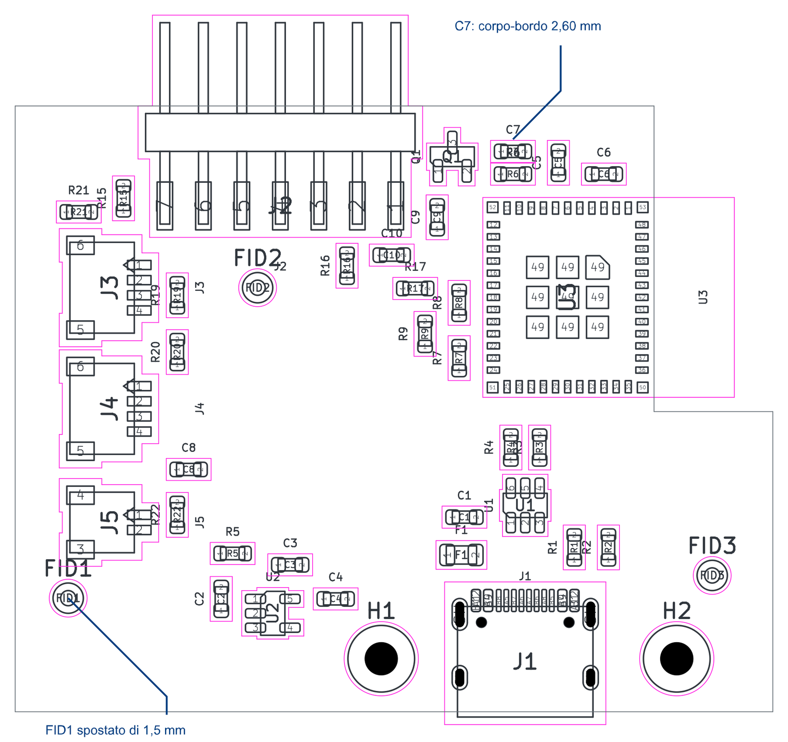

# Correzioni REV-001 e REV-003

Data: 2026-11-08. Base: commit `4fb9200b8ce6cd744c4de031d9d9a3ed25d1fb57` e [revisione precedente](../README.md). Dopo la preparazione dei file per il controllo visivo, il proprietario ha autorizzato il commit su un nuovo ramo: **`codex/pcb-edge-courtyard-fixes`**. I gate di approvazione alla produzione restano aperti.

L'intervento richiesto riguarda soltanto distanza dal bordo e courtyard incompleti. Decisioni confermate, schema, valori, codici LCSC e funzionalità sono conservati. Gli altri rilievi del rapporto precedente restano aperti.

## Modifiche al PCB

Coordinate in millimetri, origine nell'angolo superiore sinistro della scheda; la scheda nel file KiCad ha offset `(100; 100)` mm.

| Elemento | Prima | Dopo | Motivo |
|---|---|---|---|
| C7, posizione | `(32,85; 2,25)` | **`(32,85; 3,00)`** | Spostamento di 0,75 mm verso l'interno |
| C7, corpo-bordo superiore | 1,85 mm | **2,60 mm** | Supera il margine nominale di progetto di 2,5 mm |
| Via EN vicina a C7 | `(34,037; 3,5571)` | `(34,55; 3,25)` | Libera la piazzola GND del condensatore spostato |
| FID1 | `(3,50; 31,00)` | **`(3,50; 32,50)`** | Libera il courtyard completo di J5 |
| Zona di rispetto FID1 | Centrata sulla vecchia posizione | Traslata di 1,50 mm insieme al fiducial | Conserva la zona senza piste/vie/riempimenti |

Ritoccati soltanto i raccordi locali EN e GND di C7. Nessuno sbroglio globale o rigenerazione della scheda. La rete EN passa da circa 15,06 a **15,89 mm**, mantenendo 3 vie; il PCB mantiene complessivamente **55 vie**, con 537 segmenti e circa 936,731 mm di piste. Tutti i segmenti USB risultano identici alla baseline, confrontati per UUID, rete, strato, estremi e larghezza.

Le [condizioni di assemblaggio JLCPCB](https://jlcpcb.com/help/article/terms-and-conditions-of-jlcpcb-assembly-service), §2.3, sono state ricontrollate. La verifica del margine riguarda ora **tutto il contorno, intaglio incluso**, sui corpi ricavati da F.Fab. I 33 componenti ordinari controllati superano il margine nominale: C7 2,60 mm, Q1 2,70 mm; il minimo complessivo è C6, **2,51 mm dall'intaglio**, già nella posizione precedente. Le misure sono geometriche nominali, non misure su campione.

Restano eccezioni DFM esplicite **J1, J2 e U3**: connettori affacciati ai bordi e modulo sopra l'intaglio. La loro disposizione confermata è preservata e l'accettazione da parte di JLC resta aperta. La chiusura geometrica di REV-001 per C7 non dichiara approvato l'intero assemblaggio.

## Courtyard e disegni del corpo

Aggiornati questi tre footprint della libreria `PoliClock` e le quattro istanze **J2, J3, J4, J5** sul PCB:

- `HDR-SMD_7P-P2.54-H-M-W13.3-N`: courtyard sagomato con 0,5 mm nominali attorno all'inviluppo di corpo, piazzole e contatti; comprende anche i piedini sporgenti. Aggiunto il disegno del corpo e dei contatti su F.Fab. Il contorno sagomato evita di occupare inutilmente l'angolo vicino a J3.
- `CONN-SMD_4P-P1.00_SM04B-SRSS-TB-LF-SN`, usato da J3/J4: courtyard completo, incluse piazzole dei segnali e ancoraggi; aggiunti contorni F.Fab.
- `CONN-SMD_2P-P1.00_SM02B-SRSS-TB-LF-SN`, usato da J5: stessa correzione per il connettore a due poli.

Per i JST sono state adottate le geometrie F.Fab/courtyard della libreria KiCad 10, basata sul [disegno JST SH](https://www.jst-mfg.com/product/pdf/eng/eSH.pdf), con traslazione locale y = **+0,0625 mm** per allineare l'origine del footprint importato; i vertici del courtyard sono arrotondati alla griglia di 0,01 mm. Per l'header è stato usato il [disegno Hanxia rev B](https://datasheet.lcsc.com/datasheet/pdf/52d5fe703899452f89e6a3fa48d69537.pdf?productCode=C46061680) insieme alla geometria già presente. Le [convenzioni KiCad](https://klc.kicad.org/footprint/f5/f5.3/) richiedono che il courtyard includa corpo e land pattern.

**Piazzole, numeri, passo, rame, maschera, pasta, modelli 3D, campi e serigrafia dei tre footprint non sono stati cambiati.** Restano 1,02 × 3,16 mm le piazzole dell'header; la differenza rispetto ai 3,20 mm del disegno resta documentata nel rapporto precedente, fuori da questo intervento.

## Prevenzione della regressione

Nuovo controllo in sola lettura: [verifica_meccanica_pcb.py](../../../../hardware/scripts/verifica_meccanica_pcb.py).

- Controlla il margine dei corpi F.Fab rispetto a tutti i segmenti del contorno attuale; esclude testi e spessore delle linee grafiche.
- Verifica per J2–J5 che gli ingombri delle piazzole e dei disegni F.Fab siano contenuti nei courtyard.
- Elenca le tre eccezioni DFM e termina con codice non zero quando rileva un errore.
- Supporta il contorno ortogonale corrente; rifiuta archi o segmenti obliqui che richiederebbero un adattamento del controllo. Non sostituisce DRC, verifica meccanica del campione o DFM JLC.

Il generatore del PCB usa ora 2,5 mm su tutti i bordi per il posizionamento automatico e richiama questo controllo prima del salvataggio, invece del solo avviso sui lati sinistro/destro. Aggiornata la posizione di FID1 in `posizioni_main.py`.

**I generatori non sono stati eseguiti sul progetto operativo.** Il `.kicad_pcb` modificato resta la fonte per i successivi ritocchi manuali. Il generatore non riproduce necessariamente questo sbroglio locale. Lo script `esporta.py` non è stato corretto: il relativo rilievo REV-004 è rinviato come richiesto.

## Verifiche ed evidenze

KiCad usato: **10.0.6**. Controlli eseguiti con le regole esistenti, senza abbassare severità o introdurre esclusioni DRC.

| Controllo | Risultato |
|---|---|
| ERC, tutte le severità riportabili | **0 violazioni** — [JSON](erc.json) |
| DRC, zone ricalcolate, tutte le severità e tutti gli errori delle piste | **0 violazioni, 0 elementi non connessi** — [report](drc.rpt), [JSON](drc.json) |
| Parità schema ↔ PCB / corrispondenza footprint-libreria | **0 problemi riportati dal DRC** |
| Controllo geometrico sulla baseline | **FAIL atteso**: rileva C7 a 1,85 mm e piazzole fuori dai courtyard — [prima](verifica-meccanica-prima.json) |
| Stesso controllo sul PCB corretto | **PASS**, copertura J2–J5 completa — [dopo](verifica-meccanica.json) |
| Confronto semantico PCB prima/dopo | Spostati soltanto C7/FID1; modifiche al rame limitate a EN/GND; sagoma e USB identiche — [delta](delta-pcb.json) |
| Schema, progetto `.kicad_pro`, simboli e BOM | Hash invariati rispetto alla baseline |
| CPL JLCPCB | 36 componenti; cambia soltanto C7, Y dal basso: **37,750000 → 37,000000 mm** |
| Sintassi Python | File modificati analizzabili senza errori |
| Test su hardware fisico / DFM JLC / revisione del proprietario | **NOT_RUN / aperti** |

Aggiornati il CPL e il PDF di layout nella cartella hardware. Lo STEP della sola scheda rimane valido perché sagoma, intaglio e fori non cambiano. I vecchi render 3D `-top.png`/`-bottom.png` restano **storici e non aggiornati**: mancano i modelli EasyEDA locali, non versionati. Per questa revisione usare il PCB e le nuove viste 2D.

## File da aprire per la verifica a vista

1. **[PCB operativo corretto](../../../../hardware/policlock-main/policlock-main.kicad_pcb)** in KiCad. Attivare F.Fab e F.CrtYd; controllare C7 in alto, raccordi EN/GND e via, J2–J5 e FID1 in basso a sinistra. Eseguire anche una vista dei due strati di rame.
2. **[Vista annotata SVG](pcb-courtyard.svg)** / **[anteprima PNG](pcb-courtyard.png)**: courtyard magenta, geometrie scure, richiami blu su C7/FID1. ViewBox allargato per includere i piedini fuori scheda; colori e richiami sono soltanto di presentazione.
3. **[Vista PDF dei courtyard](pcb-courtyard.pdf)** e **[layout completo](../../../../hardware/policlock-main/policlock-main-layout.pdf)**: il secondo contiene F.Fab, F.Cu, B.Cu e B.SilkS. Scala del PDF 3,8:1 per includere i contatti sporgenti senza tagli; non usare la stampa come sagoma 1:1.



Comando del controllo geometrico dalla root:

```powershell
& 'C:\Program Files\KiCad\10.0\bin\python.exe' hardware/scripts/verifica_meccanica_pcb.py
```

**Stato:** REV-001 corretto per C7 e controllo esteso; REV-003 corretto per libreria e PCB. Commit delle correzioni autorizzato dal proprietario su ramo dedicato. REV-002, REV-004, REV-005, REV-006 e REV-007 restano aperti. Nessuna nuova decisione di prodotto e nessun ordine autorizzato da questa nota.
